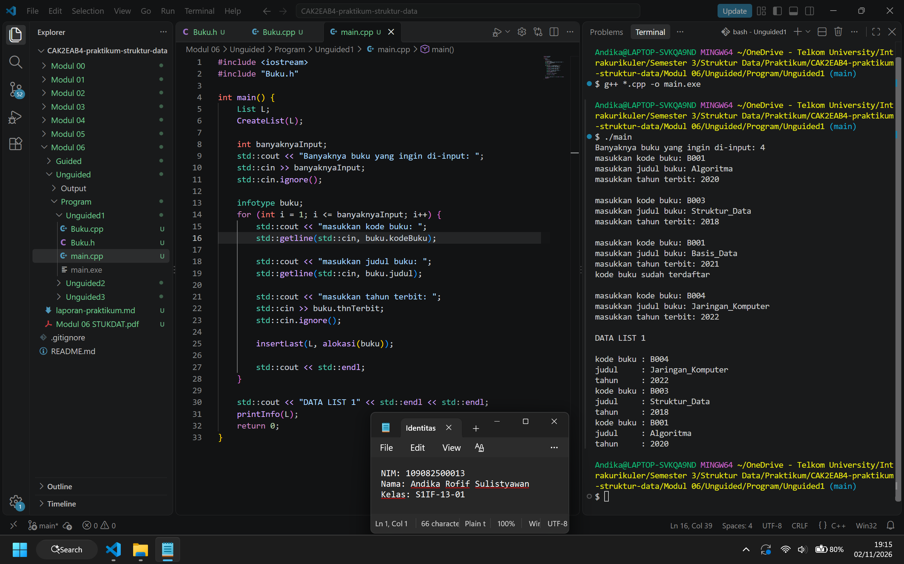
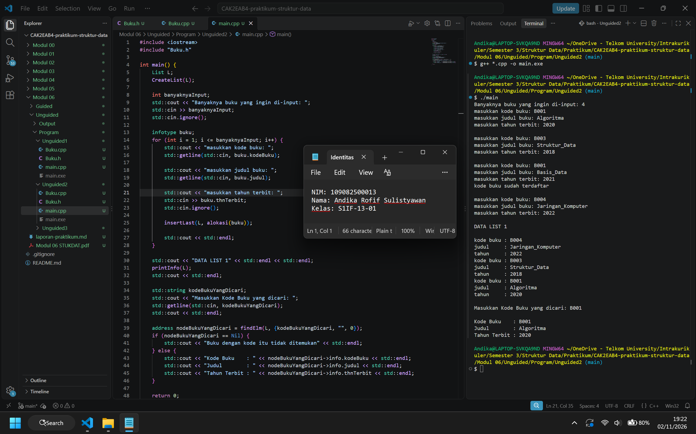
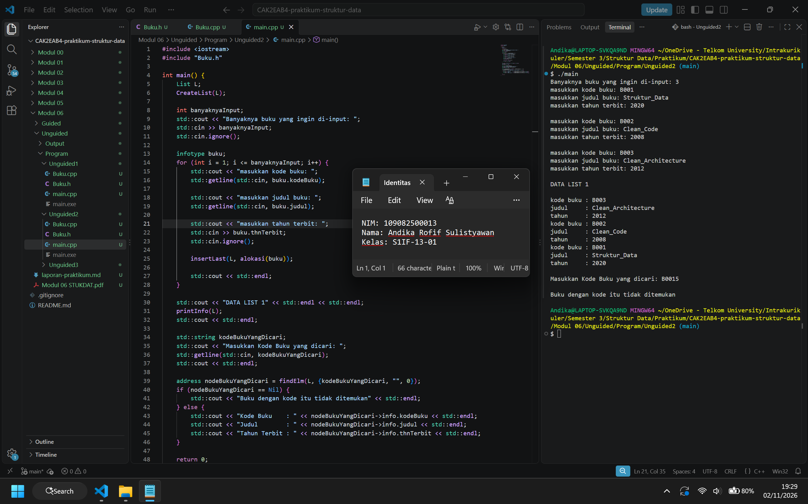
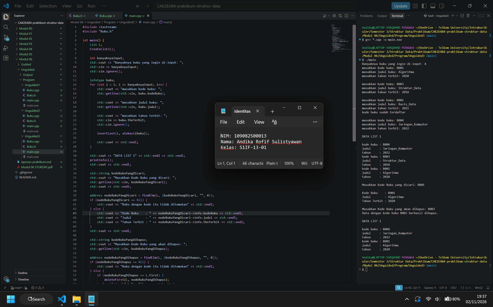
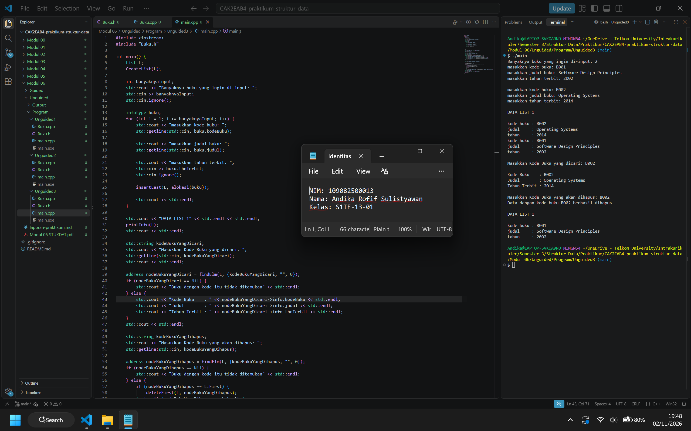
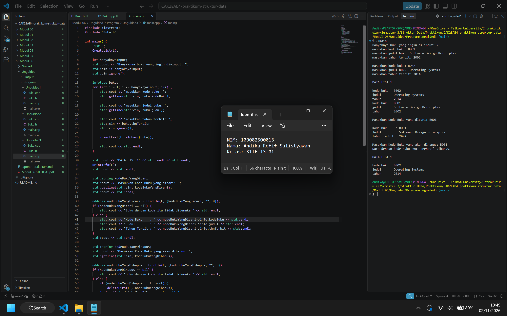
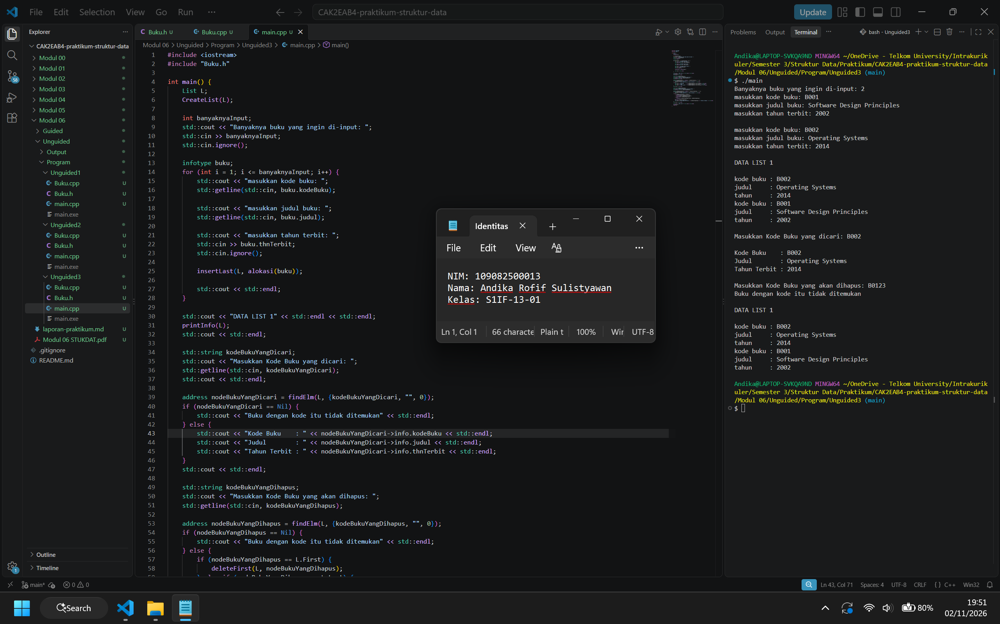

# <h1 align="center">Laporan Praktikum Modul 6 - Doubly Linked List (Bagian Pertama)</h1>
<p align="center">Andika Rofif Sulistyawan - 109082500013</p>

## Dasar Teori

### A. Struktur Data<br/>
Struktur data adalah cara untuk mengorganisasi dan menyimpan data agar data dapat diakses serta dikelola sesuai kebutuhan. Pemilihan struktur data memengaruhi cara penyimpanan, pengaksesan, penambahan, dan penghapusan elemen. Array menyimpan elemen pada lokasi memori yang berurutan sehingga elemen dapat diakses melalui indeks, sedangkan linked list menghubungkan elemen menggunakan pointer. Linked list dapat menjadi pilihan ketika data sering mengalami perubahan karena penambahan dan penghapusan elemen tidak mengharuskan elemen lain digeser seperti pada array[3]

### B. Abstract Data Type (ADT)<br/>
Abstract Data Type (ADT) adalah model yang menjelaskan jenis data, karakteristik data, dan operasi yang dapat dilakukan terhadap data tanpa mengharuskan pengguna mengetahui detail implementasinya. ADT memisahkan antarmuka operasi dari cara operasi tersebut diwujudkan. Pada ADT list, data disusun sebagai kumpulan elemen berurutan dan operasi yang umum disediakan meliputi pembuatan list kosong, pemeriksaan kondisi kosong, penambahan elemen, penghapusan elemen, penelusuran elemen, serta penghitungan banyaknya elemen. Pemisahan ini membantu membuat definisi struktur data lebih terorganisasi dan memudahkan implementasi maupun pemeliharaannya[1][2]

### C. Pointer
Pointer adalah variabel yang digunakan untuk menyimpan alamat memori dari variabel atau objek lain. Berbeda dengan variabel biasa yang menyimpan nilai secara langsung, pointer menyimpan alamat yang memungkinkan program mengakses data melalui alamat tersebut. Dalam bahasa C++, pointer dapat digunakan untuk mengakses anggota suatu objek atau struktur melalui operator dereference (*) dan operator panah (->). Pointer juga memiliki nilai khusus nullptr (ekuivalen dengan NULL atau Nil) yang menunjukkan bahwa pointer tidak sedang menunjuk ke suatu objek atau lokasi memori tertentu. Dalam implementasi struktur data dinamis, pointer berperan penting untuk menghubungkan elemen-elemen data yang disimpan pada lokasi memori berbeda. Penggunaan pointer juga berkaitan dengan pengelolaan memori, seperti proses alokasi dan pembebasan memori secara manual dalam bahasa C++

### D. Doubly Linked List<br/>
#### 1. Definisi Doubly Linked List
Doubly Linked List merupakan salah satu jenis linked list yang setiap elemennya terdiri dari sebuah node yang saling terhubung melalui dua pointer, yaitu pointer next dan pointer prev. Pointer next digunakan untuk menunjuk node berikutnya, sedangkan pointer prev digunakan untuk menunjuk node sebelumnya. Setiap node juga memiliki bagian info yang digunakan untuk menyimpan data. Struktur doubly linked list umumnya memiliki pointer First untuk menunjuk node pertama dan pointer Last untuk menunjuk node terakhir. Pada node pertama, pointer prev bernilai Nil, sedangkan pada node terakhir, pointer next bernilai Nil. Keberadaan dua pointer tersebut memungkinkan proses penelusuran data dilakukan dari awal ke akhir maupun dari akhir ke awal sehingga doubly linked list dapat dilalui dalam dua arah[4].

#### 2. Operasi Penyisipan Node pada Doubly Linked List
Penyisipan node (insertion) merupakan operasi untuk menambahkan elemen baru ke dalam doubly linked list. Penyisipan dapat dilakukan pada beberapa posisi, yaitu di awal list (insert first), di akhir list (insert last), setelah node tertentu (insert after), dan sebelum node tertentu (insert before)[4]. Proses penyisipan dilakukan dengan mengalokasikan memori untuk node baru, kemudian mengatur pointer next dan prev agar node baru terhubung dengan node lain sesuai posisinya. Pada penyisipan di awal, pointer First diperbarui agar menunjuk node baru, sedangkan pada penyisipan di akhir, pointer Last diperbarui. Penyisipan di tengah list dilakukan dengan menghubungkan node baru ke node sebelum dan sesudahnya serta menyesuaikan pointer pada kedua node tersebut. Apabila list masih kosong, node yang baru ditambahkan akan menjadi elemen pertama sekaligus elemen terakhir. Pengaturan hubungan antarpointer diperlukan agar urutan node tetap terjaga dan penelusuran list dapat dilakukan dengan benar.

#### 3. Operasi Penelusuran Node pada Doubly Linked List
Penelusuran node (traversal) merupakan proses mengunjungi elemen-elemen dalam linked list secara berurutan untuk membaca, menampilkan, atau mencari data tertentu. Pada doubly linked list, penelusuran dapat dilakukan dari node pertama menggunakan pointer next maupun dari node terakhir menggunakan pointer prev. Proses pencarian data (searching) dapat dilakukan dengan membandingkan nilai pada bagian info setiap node dengan nilai yang ingin ditemukan. Penelusuran dimulai dari salah satu ujung list, kemudian berpindah dari satu node ke node berikutnya sampai data yang dicari ditemukan atau pointer mencapai Nil. Apabila pointer telah mencapai Nil tanpa menemukan data yang sesuai, dapat disimpulkan bahwa data tersebut tidak terdapat dalam list. Pencarian pada linked list umumnya dilakukan secara berurutan karena setiap node diakses melalui hubungan pointer, sehingga waktu pencarian dapat bergantung pada banyaknya node yang perlu diperiksa[5].

#### 4. Operasi Penghapusan Node pada Doubly Linked List
Penghapusan node (deletion) merupakan operasi untuk mengeluarkan elemen tertentu dari doubly linked list. Penghapusan dapat dilakukan pada awal list (delete first), akhir list (delete last), maupun setelah node tertentu (delete after)[4]. Proses penghapusan dilakukan dengan mengatur kembali hubungan pointer pada node yang berada sebelum dan sesudah node yang akan dihapus. Pada penghapusan node pertama, pointer First dipindahkan ke node berikutnya dan pointer prev pada node baru pertama diatur menjadi Nil. Sementara itu, pada penghapusan node terakhir, pointer Last dipindahkan ke node sebelumnya dan pointer next pada node baru terakhir diatur menjadi Nil. Penghapusan node di tengah list dilakukan dengan menghubungkan node sebelumnya secara langsung dengan node sesudahnya sehingga node yang dihapus tidak lagi menjadi bagian dari list. Apabila hanya terdapat satu node dalam list, penghapusan akan menyebabkan pointer First dan Last sama-sama bernilai Nil. Setelah hubungan antarnode diperbarui dan node dilepaskan dari list, memori yang digunakan oleh node tersebut perlu dibebaskan agar tidak terjadi penggunaan memori yang tidak diperlukan[4].

## Guided 

### 1. Guided 1: Abstract Data Type untuk Doubly Linked List Kendaraan

**`Doublylist.h`**
```h
#ifndef DOUBLYLIST_H
#define DOUBLYLIST_H

#include <iostream>
#include <string>

#define Nil NULL

// Latihan 1
struct infotype {
    std::string nopol; 
    std::string warna; 
    int thnBuat;      
};
typedef struct elmlist *address;
struct elmlist {
    infotype info;  
    address next;   
    address prev;   
};
struct List {
    address First; 
    address Last;  
};


// Latihan 1
void CreateList(List &L);
address alokasi(infotype x);
void dealokasi(address &P);
void printInfo(List L);
void insertLast(List &L, address P);

// Latihan 2

address findElm(List L, std::string nopol);

// Latihan 3
void deleteFirst(List &L, address &P);
void deleteLast(List &L, address &P);
void deleteAfter(List &L, address Prec, address &P);
void deleteElm(List &L, std::string nopol, bool &status);

#endif
```

**`Doublylist.cpp`**
```C++
#include "Doublylist.h"

// Latihan 1
void CreateList(List &L) {
    L.First = Nil;
    L.Last = Nil;
}

address alokasi(infotype x) {
    address P = new elmlist;
    P->info = x;
    P->next = Nil;
    P->prev = Nil; 
    return P;
}

void dealokasi(address &P) {
    delete P;
}

void printInfo(List L) {
    address P = L.Last;
    if (P == Nil) {
        std::cout << "List kosong." << std::endl;
        return;
    }
    while (P != Nil) {
        std::cout << "no polisi : " << P->info.nopol << std::endl;   
        std::cout << "warna     : " << P->info.warna << std::endl;   
        std::cout << "tahun     : " << P->info.thnBuat << std::endl; 
        P = P->prev;
    }
}

void insertLast(List &L, address P) {
    if (L.First == Nil) { 
        L.First = P;
        L.Last = P;
    } else {
        P->prev = L.Last;         
        (L.Last)->next = P;     
        L.Last = P;               
    }
}

// Latihan 2
address findElm(List L, std::string nopol) {
    address P = L.First;
    while (P != Nil) {
        if (P->info.nopol == nopol) {
            return P;
        }
        P = P->next;
    }
    return Nil;
}

// Latihan 3
void deleteFirst(List &L, address &P) {
    if (L.First == Nil) return;

    P = L.First; 
    if (L.First == L.Last) { 
        L.First = Nil;
        L.Last = Nil;
    } else {
        L.First = P->next;     
        (L.First)->prev = Nil; 
        P->next = Nil;         
    }
}

void deleteLast(List &L, address &P) {
    if (L.First == Nil) return;

    P = L.Last; 
    if (L.First == L.Last) { 
        L.First = Nil;
        L.Last = Nil;
    } else {
        L.Last = P->prev;      
        (L.Last)->next = Nil; 
        P->prev = Nil;         
    }
}

void deleteAfter(List &L, address Prec, address &P) {
    if (Prec == Nil || Prec->next == Nil) return;

    P = Prec->next;
    if (P == L.Last) {
        deleteLast(L, P);
    } else {
        Prec->next = P->next;     
        (P->next)->prev = Prec; 
        P->next = Nil;            
        P->prev = Nil;           
    }
}

void deleteElm(List &L, std::string nopol, bool &status) {
    address P = findElm(L, nopol);
    status = false;

    if (P != Nil) {
        if (P == L.First) {
            deleteFirst(L, P);
        } else if (P == L.Last) {
            deleteLast(L, P);
        } else {
            address Prec = P->prev;
            deleteAfter(L, Prec, P);
        }
        dealokasi(P); 
        status = true;
    }
}
```

**`main.cpp`**
```C++
#include <iostream>
#include "Doublylist.h"
using namespace std;

void inputData(List &L) {
    infotype data;
    address P;

    cout << "masukkan nomor polisi: "; cin >> data.nopol;
    cout << "masukkan warna kendaraan: "; cin >> data.warna;
    cout << "masukkan tahun kendaraan: "; cin >> data.thnBuat;
    if (findElm(L, data.nopol) == Nil) {
        P = alokasi(data); 
        insertLast(L, P);  
    } else {
        cout << "nomor polisi sudah terdaftar" << endl; 
    }
}

int main() {
    List L;
    CreateList(L); 
    address P;

    // Latihan 1
    inputData(L); 
    inputData(L); 
    inputData(L); 
    inputData(L); 

    cout << "\nDATA LIST 1" << endl; 
    printInfo(L); 

    // Latihan 2
    string nopolCari;
    cout << "\nMasukkan Nomor Polisi yang dicari : "; 
    cin >> nopolCari; 
    
    P = findElm(L, nopolCari); 
    if (P != Nil) {
        cout << "Nomor Polisi : " << P->info.nopol << endl; 
        cout << "Warna        : " << P->info.warna << endl; 
        cout << "Tahun        : " << P->info.thnBuat << endl; 
    } else {
        cout << "Data dengan nomor polisi " << nopolCari << " tidak ditemukan." << endl;
    }

    // Latihan 3
    string nopolHapus;
    bool hapusBerhasil;
    cout << "\nMasukkan Nomor Polisi yang akan dihapus : ";
    cin >> nopolHapus;

    deleteElm(L, nopolHapus, hapusBerhasil); 

    if (hapusBerhasil) {
        cout << "Data dengan nomor polisi " << nopolHapus << " berhasil dihapus." << endl; 
    } else {
        cout << "Data dengan nomor polisi " << nopolHapus << " tidak ditemukan." << endl;
    }
    cout << "\nDATA LIST 1" << endl; 
    printInfo(L); 

    return 0;
}
```

Program di atas merupakan implementasi ADT doubly linked list untuk mengelola data kendaraan yang terdiri dari nomor polisi, warna, dan tahun pembuatan. Program tersebut menggunakan prosedur `CreateList` untuk membuat list kosong, `alokasi` untuk membuat node baru, serta `insertLast` untuk menambahkan data kendaraan di akhir list. Fungsi `findElm` digunakan untuk mencari kendaraan berdasarkan nomor polisi dengan menelusuri node melalui pointer `next`. Selain itu, program dilengkapi prosedur `deleteFirst`, `deleteLast`, dan `deleteAfter` untuk menghapus node berdasarkan posisinya, serta prosedur `deleteElm` untuk menentukan proses penghapusan sesuai posisi node yang ditemukan. Pada file `main.cpp`, user bisa memasukkan empat data kendaraan, menampilkan seluruh data dari akhir ke awal, mencari kendaraan berdasarkan nomor polisi, dan menghapus data kendaraan yang diinginkan. Program juga melakukan pengecekan nomor polisi agar tidak terjadi duplikasi data serta menampilkan pesan sesuai keberhasilan proses pencarian dan penghapusan

## Unguided 

### 1. Unguided 1: Abstract Data Type untuk Doubly Linked List Buku
#### Soal
Buatlah ADT Doubly Linked List sebagai berikut di dalam file "Buku.h":
```text
Type infotype : buku < 
    kodeBuku  : string 
    judul     : string 
    thnTerbit : integer 
> 
 
Type address : pointer to ElmList 
Type ElmList < 
    info : infotype 
    next : address 
    prev : address 
> 
 
Type List < 
    First : address 
    Last  : address 
> 
 
procedure CreateList( input/output L : List ) 
function alokasi( x : infotype ) -> address 
procedure dealokasi( input/output P : address ) 
procedure printInfo( input L : List ) 
procedure insertLast( input/output L : List, input P : address )
```
Buatlah implementasi ADT Doubly Linked List pada file “Buku.cpp" dan cobalah hasil implementasi ADT tersebut pada file "main.cpp". Pastikan sistem melakukan pengecekan duplikasi kodeBuku sebelum memasukkan data baru ke dalam list.

Contoh Output:
```text
masukkan kode buku: B001 
masukkan judul buku: Algoritma 
masukkan tahun terbit: 2020 
 
masukkan kode buku: B003 
masukkan judul buku: Struktur_Data 
masukkan tahun terbit: 2018 
 
masukkan kode buku: B001 
masukkan judul buku: Basis_Data 
masukkan tahun terbit: 2021 
kode buku sudah terdaftar 
 
masukkan kode buku: B004 
masukkan judul buku: Jaringan_Komputer 
masukkan tahun terbit: 2022 
 
DATA LIST 1 
 
kode buku   : B004 
judul       : Jaringan_Komputer 
tahun       : 2022 
kode buku   : B003 
judul       : Struktur_Data 
tahun       : 2018 
kode buku   : B001 
judul       : Algoritma 
tahun       : 2020 
```

#### Jawaban

**`Buku.h`**
```h
#ifndef BUKU_H
#define BUKU_H

#include <string>
#define Nil NULL

struct buku {
    std::string kodeBuku;
    std::string judul;
    int thnTerbit;
};

typedef buku infotype;
typedef struct ElmList* address;
struct ElmList {
    infotype info;
    address next;
    address prev;
};
struct List {
    address First;
    address Last;
};

void CreateList(List& L);
address alokasi(infotype x);
void dealokasi(address& P);
void printInfo(List L);
void insertLast(List& L, address P);

#endif
```

**`Buku.cpp`**
```C++
#include <iostream>
#include "Buku.h"

void CreateList(List& L) {
    // I.S.: terdefinisi doubly list L
    // F.S.: doubly list L menjadi doubly list kosong
    L.First = Nil;
    L.Last = Nil;
}
address alokasi(infotype x) {
    // mengembalikan alamat memori elemen doubly list baru dengan info x jika alokasi memori berhasil
    return new ElmList{x, Nil, Nil};
}
void dealokasi(address& P) {
    // I.S.: terdefinisi pointer P yang menunjuk elemen doubly list yang telah dialokasikan
    // F.S.: memori P dibebaskan dan P menjadi Nil
    delete P;
    P = Nil;
}
void printInfo(List L) {
    // I.S.: terdefinisi doubly list L yang kosong atau berisi
    // F.S.: menampilkan semua info dalam doubly list L dari akhir hingga awal jika L berisi, atau menampilkan string "List buku kosong" jika L kosong. L tidak berubah
    if (L.Last == Nil) {
        std::cout << "List buku kosong" << std::endl;
    } else {
        address node = L.Last;
        while (node != Nil) {
            std::cout << "kode buku : " << node->info.kodeBuku << std::endl;
            std::cout << "judul     : " << node->info.judul << std::endl;
            std::cout << "tahun     : " << node->info.thnTerbit << std::endl;
            node = node->prev;
        }
    }
}
void insertLast(List& L, address P) {
    // I.S.: terdefinisi doubly list L dan pointer P yang menunjuk elemen doubly list yang telah dialokasikan
    // F.S.: elemen doubly list yang ditunjuk pointer P menjadi elemen terakhir doubly list L jika tidak ada duplikasi kodeBuku, atau menampilkan string "kode buku sudah terdaftar" jika ditemukan duplikasi kodeBuku
    if (L.Last == Nil) {
        L.First = P;
        L.Last = P;
    } else {
        address node = L.First;
        while (node != Nil) {
            if (node->info.kodeBuku == P->info.kodeBuku) {
                std::cout << "kode buku sudah terdaftar" << std::endl;
                return;
            }
            node = node->next;
        }
        P->prev = L.Last;
        L.Last->next = P;
        L.Last = P;
    }
}
```

**`main.cpp`**
```C++
#include <iostream>
#include "Buku.h"

int main() {
    List L;
    CreateList(L);
    
    int banyaknyaInput;
    std::cout << "Banyaknya buku yang ingin di-input: ";
    std::cin >> banyaknyaInput;
    std::cin.ignore();
    
    infotype buku;
    for (int i = 1; i <= banyaknyaInput; i++) {        
        std::cout << "masukkan kode buku: ";
        std::getline(std::cin, buku.kodeBuku);
        
        std::cout << "masukkan judul buku: ";
        std::getline(std::cin, buku.judul);
        
        std::cout << "masukkan tahun terbit: ";
        std::cin >> buku.thnTerbit;
        std::cin.ignore();
        
        insertLast(L, alokasi(buku));
        
        std::cout << std::endl;
    }
    
    std::cout << "DATA LIST 1" << std::endl << std::endl;
    printInfo(L);
    return 0;
}
```

##### Output Unguided 1 :

###### Output 1


Program di atas merupakan program untuk mengimplementasikan struktur data Doubly Linked List yang digunakan untuk menyimpan data buku menggunakan bahasa C++. Program terdiri dari tiga file, yaitu `Buku.h` sebagai header file yang berisi deklarasi struktur data dan prototype subprogram, `Buku.cpp` sebagai implementation file yang berisi implementasi subprogram, serta `main.cpp` sebagai driver file yang digunakan untuk menjalankan program. Struktur data tersebut menyimpan elemen dalam bentuk node yang masing-masing memiliki tiga bagian utama, yaitu `info` untuk menyimpan informasi buku, `next` untuk menyimpan alamat node berikutnya, dan `prev` untuk menyimpan alamat node sebelumnya. Selain itu, struktur Doubly Linked List memiliki pointer `First` dan `Last` yang masing-masing menunjuk ke elemen pertama dan elemen terakhir dalam list. Program tersebut digunakan untuk memasukkan data buku ke dalam list dengan menerapkan pengecekan duplikasi kode buku, kemudian menampilkan seluruh data buku dari elemen terakhir hingga elemen pertama

Dalam file `Buku.h`, terdapat direktif `#ifndef BUKU_H`, `#define BUKU_H`, dan `#endif` yang digunakan sebagai header guard untuk mencegah header file `BUKU_H` diproses berulang kali. Selanjutnya, direktif `#include <string>` digunakan untuk menyediakan tipe data `std::string` yang diperlukan dalam menyimpan kode buku dan judul buku. Ada pula deklarasi `#define Nil NULL` yang digunakan untuk mendefinisikan `Nil` sebagai alias dari `NULL`, yaitu nilai yang menandakan bahwa suatu pointer tidak menunjuk ke elemen mana pun. Struct `buku` didefinisikan dengan tiga atribut, yaitu `kodeBuku` bertipe `std::string` untuk menyimpan kode identitas buku, `judul` bertipe `std::string` untuk menyimpan judul buku, dan `thnTerbit` bertipe `int` untuk menyimpan tahun terbit buku. Selanjutnya, tipe `infotype` didefinisikan sebagai alias untuk struct `buku` menggunakan syntax `typedef buku infotype`, sehingga informasi buku bisa direpresentasikan menggunakan tipe `infotype`. Tipe `address` didefinisikan sebagai alias untuk pointer to struct `ElmList` melalui syntax `typedef struct ElmList* address`. Struct `ElmList` memiliki atribut `info` bertipe `infotype` untuk menyimpan informasi buku, `next` bertipe `address` untuk menunjuk ke elemen berikutnya, dan `prev` bertipe `address` untuk menunjuk ke elemen sebelumnya. Dengan adanya atribut `next` dan `prev`, setiap elemen dalam Doubly Linked List bisa saling terhubung dan memungkinkan penelusuran list dilakukan dari dua arah. Kemudian, struct `List` memiliki atribut `First` dan `Last` yang bertipe `address`. Atribut `First` digunakan untuk menyimpan alamat elemen pertama dalam list, sedangkan atribut `Last` digunakan untuk menyimpan alamat elemen terakhir. Pada bagian akhir file, terdapat deklarasi subprogram berupa `CreateList(List& L)` untuk membuat list kosong, `alokasi(infotype x)` untuk mengalokasikan memori elemen baru, `dealokasi(address& P)` untuk membebaskan memori elemen, `printInfo(List L)` untuk menampilkan informasi buku dalam list, serta `insertLast(List& L, address P)` untuk menambahkan elemen baru pada posisi terakhir list

Dalam file `Buku.cpp`, didefinisikan implementasi dari setiap subprogram yang telah terdefinisi dalam file `Buku.h`. Pada bagian awal program terdapat direktif `#include <iostream>` yang digunakan untuk mengakses fasilitas input dan output, seperti `std::cout` dan `std::endl`, serta `#include "Buku.h"` yang digunakan untuk mengakses deklarasi struktur data dan subprogram ADT Doubly Linked List buku. Pertama, prosedur `CreateList(List& L)` digunakan untuk menginisialisasi list dengan mengatur atribut `L.First = Nil` dan `L.Last = Nil`, sehingga list berada dalam keadaan kosong. Parameter `L` menggunakan reference agar perubahan terhadap list bisa langsung diterapkan pada list yang digunakan dalam program utama. Selanjutnya, fungsi `alokasi(infotype x)` digunakan untuk mengalokasikan memori bagi elemen baru yang berisi informasi buku `x`. Fungsi tersebut mengembalikan alamat elemen baru menggunakan syntax `new ElmList{x, Nil, Nil}`, yang berarti atribut `info` diisi dengan data buku `x`, sedangkan atribut `next` dan `prev` diinisialisasi dengan `Nil`. Dengan demikian, elemen baru yang berhasil dialokasikan belum terhubung dengan elemen lain dalam list. Prosedur `dealokasi(address& P)` digunakan untuk membebaskan memori elemen yang ditunjuk oleh pointer `P` menggunakan syntax `delete P`, kemudian mengatur `P = Nil` agar pointer tidak lagi menunjuk ke alamat memori yang telah dibebaskan. Selanjutnya, prosedur `printInfo(List L)` digunakan untuk menampilkan seluruh informasi buku yang terdapat dalam list. Pada awal prosedur dilakukan pengecekan terhadap `L.Last`. Apabila `L.Last == Nil`, maka program menampilkan pesan `"List buku kosong"` yang menunjukkan bahwa list belum memiliki elemen. Sebaliknya, apabila list berisi elemen, variabel `node` bertipe `address` diinisialisasi dengan `L.Last` agar proses penelusuran dimulai dari elemen terakhir. Perulangan `while (node != Nil)` digunakan untuk menelusuri elemen-elemen list hingga pointer `node` mencapai `Nil`. Di dalam perulangan tersebut, program menampilkan atribut `kodeBuku`, `judul`, dan `thnTerbit` dari elemen yang sedang ditunjuk oleh `node` menggunakan syntax `node->info.kodeBuku`, `node->info.judul`, dan `node->info.thnTerbit`. Setelah informasi buku ditampilkan, perintah `node = node->prev` digunakan untuk memindahkan pointer `node` menuju elemen sebelumnya. Dengan demikian, proses penampilan data berlangsung dari elemen terakhir menuju elemen pertama tanpa mengubah struktur list. Terakhir, prosedur `insertLast(List& L, address P)` digunakan untuk menambahkan elemen buku baru pada posisi terakhir list. Pada awal prosedur dilakukan pengecekan kondisi list melalui `if (L.Last == Nil)`. Apabila list masih kosong, maka pointer `L.First` dan `L.Last` diatur agar keduanya menunjuk ke elemen `P`. Hal tersebut menunjukkan bahwa elemen baru menjadi elemen pertama sekaligus elemen terakhir dalam list. Namun, apabila list telah memiliki elemen, program melakukan pengecekan duplikasi kode buku dengan menginisialisasi variabel `node` menggunakan `L.First`. Perulangan `while (node != Nil)` digunakan untuk menelusuri seluruh elemen yang telah terdapat dalam list. Pada setiap iterasi, program membandingkan nilai `node->info.kodeBuku` dengan `P->info.kodeBuku`. Apabila kedua kode buku memiliki nilai yang sama, program menampilkan pesan `"kode buku sudah terdaftar"` dan menjalankan syntax `return` untuk menghentikan prosedur sehingga elemen baru tidak dimasukkan ke dalam list. Apabila tidak ditemukan duplikasi, pointer `node` berpindah ke elemen berikutnya menggunakan `node = node->next` hingga seluruh elemen selesai diperiksa. Setelah proses pengecekan selesai, elemen baru dihubungkan dengan elemen terakhir sebelumnya melalui perintah `P->prev = L.Last` yang digunakan untuk mengatur pointer `prev` pada elemen baru agar menunjuk ke elemen terakhir sebelumnya. Kemudian, perintah `L.Last->next = P` digunakan untuk menghubungkan elemen terakhir sebelumnya dengan elemen baru melalui pointer `next`. Terakhir, perintah `L.Last = P` digunakan untuk memperbarui pointer `Last` agar menunjuk ke elemen baru yang telah ditambahkan. Dengan urutan tersebut, elemen baru menjadi elemen terakhir dalam Doubly Linked List dan tetap terhubung dengan elemen-elemen lainnya

Dalam file `main.cpp`, program mendeklarasikan variabel `L` bertipe `List` yang digunakan untuk menyimpan data buku dalam Doubly Linked List. Prosedur `CreateList(L)` dipanggil terlebih dahulu untuk menginisialisasi list agar berada dalam keadaan kosong. Setelah itu, program mendeklarasikan variabel `banyaknyaInput` bertipe `int` yang digunakan untuk menyimpan banyaknya buku yang ingin dimasukkan oleh user. Perintah `std::cout` digunakan untuk menampilkan pesan `"Banyaknya buku yang ingin di-input: "`, sedangkan `std::cin >> banyaknyaInput` digunakan untuk membaca banyaknya buku yang akan diinputkan. Selanjutnya, perintah `std::cin.ignore()` digunakan untuk mengabaikan karakter newline yang tersisa pada buffer input setelah user memasukkan banyaknya buku. Kemudian, program mendeklarasikan variabel `buku` bertipe `infotype` yang digunakan sebagai tempat penyimpanan sementara informasi buku yang akan dimasukkan ke dalam list. Perulangan `for (int i = 1; i <= banyaknyaInput; i++)` digunakan untuk menjalankan proses input data buku sebanyak yang telah ditentukan oleh user. Pada setiap iterasi, program menampilkan pesan `"masukkan kode buku: "` dan membaca kode buku menggunakan `std::getline(std::cin, buku.kodeBuku)`. Penggunaan `std::getline()` memungkinkan kode buku dibaca sebagai string secara keseluruhan. Setelah itu, program menampilkan pesan `"masukkan judul buku: "` dan membaca judul buku menggunakan `std::getline(std::cin, buku.judul)`, sehingga judul buku yang mengandung spasi bisa dibaca dengan baik. Selanjutnya, program menampilkan pesan `"masukkan tahun terbit: "` dan membaca tahun terbit buku menggunakan `std::cin >> buku.thnTerbit`. Setelah proses input tahun terbit selesai, perintah `std::cin.ignore()` digunakan untuk mengabaikan karakter newline yang tersisa pada buffer input agar proses input data buku berikutnya bisa dilakukan dengan benar. Data buku yang telah diinputkan kemudian dimasukkan ke dalam list melalui perintah `insertLast(L, alokasi(buku))`. Pada perintah tersebut, fungsi `alokasi(buku)` terlebih dahulu mengalokasikan memori untuk elemen baru yang berisi informasi buku, kemudian alamat elemen tersebut diteruskan ke prosedur `insertLast()`. Prosedur `insertLast()` selanjutnya melakukan pengecekan terhadap kode buku untuk memastikan tidak terdapat duplikasi sebelum elemen dimasukkan ke dalam list. Apabila kode buku belum terdaftar, elemen buku akan ditambahkan pada posisi terakhir list. Namun, apabila kode buku telah terdaftar, program menampilkan pesan `"kode buku sudah terdaftar"` dan elemen tersebut tidak dimasukkan ke dalam list. Setelah setiap proses input selesai dilakukan, perintah `std::cout << std::endl` digunakan untuk memberikan baris kosong agar tampilan input data buku menjadi lebih rapi. Setelah perulangan `for` selesai dijalankan, program menampilkan teks `"DATA LIST 1"` diikuti dengan dua baris baru menggunakan `std::endl`. Kemudian, prosedur `printInfo(L)` dipanggil untuk menampilkan seluruh informasi buku yang berhasil dimasukkan ke dalam list. Karena prosedur `printInfo()` melakukan traversal mulai dari pointer `Last` menuju pointer `First` menggunakan atribut `prev`, maka data buku ditampilkan dalam urutan terbalik dari urutan input. Sebagai contoh, apabila user memasukkan buku dengan kode `B001`, `B003`, `B001`, dan `B004`, maka buku dengan kode `B001` yang dimasukkan pada input ketiga tidak akan ditambahkan karena kode tersebut telah terdaftar. Oleh karena itu, data yang berhasil disimpan dalam list adalah buku `B001`, `B003`, dan `B004`. Ketika prosedur `printInfo()` dijalankan, data buku akan ditampilkan dengan urutan `B004`, `B003`, dan `B001`. Terakhir, statement `return 0` dijalankan untuk menandakan bahwa program telah selesai dieksekusi secara normal

### 2. Unguided 2: Penambahan Fungsi findElm pada ADT Sebelumnya
#### Soal
Carilah elemen dengan kode buku B001 dengan membuat fungsi baru:
```text
fungsi findElm( L : List, x : infotype ) : address
```

Contoh Output Pencarian: 
```text
Masukkan Kode Buku yang dicari : B001 
 
Kode Buku    : B001 
Judul        : Algoritma 
Tahun Terbit : 2020
```

#### Jawaban
**`Buku.h`**
```h
#ifndef BUKU_H
#define BUKU_H

#include <string>
#define Nil NULL

struct buku {
    std::string kodeBuku;
    std::string judul;
    int thnTerbit;
};

typedef buku infotype;
typedef struct ElmList* address;
struct ElmList {
    infotype info;
    address next;
    address prev;
};
struct List {
    address First;
    address Last;
};

void CreateList(List& L);
address alokasi(infotype x);
void dealokasi(address& P);
void printInfo(List L);
void insertLast(List& L, address P);
address findElm(List L, infotype x);

#endif
```

**`Buku.cpp`**
```C++
#include <iostream>
#include "Buku.h"

void CreateList(List& L) {
    // I.S.: terdefinisi doubly list L
    // F.S.: doubly list L menjadi doubly list kosong
    L.First = Nil;
    L.Last = Nil;
}
address alokasi(infotype x) {
    // mengembalikan alamat memori elemen doubly list baru dengan info x jika alokasi memori berhasil
    return new ElmList{x, Nil, Nil};
}
void dealokasi(address& P) {
    // I.S.: terdefinisi pointer P yang menunjuk elemen doubly list yang telah dialokasikan
    // F.S.: memori P dibebaskan dan P menjadi Nil
    delete P;
    P = Nil;
}
void printInfo(List L) {
    // I.S.: terdefinisi doubly list L yang kosong atau berisi
    // F.S.: menampilkan semua info dalam doubly list L dari akhir hingga awal jika L berisi, atau menampilkan string "List buku kosong" jika L kosong. L tidak berubah
    if (L.Last == Nil) {
        std::cout << "List buku kosong" << std::endl;
    } else {
        address node = L.Last;
        while (node != Nil) {
            std::cout << "kode buku : " << node->info.kodeBuku << std::endl;
            std::cout << "judul     : " << node->info.judul << std::endl;
            std::cout << "tahun     : " << node->info.thnTerbit << std::endl;
            node = node->prev;
        }
    }
}
void insertLast(List& L, address P) {
    // I.S.: terdefinisi doubly list L dan pointer P yang menunjuk elemen doubly list yang telah dialokasikan
    // F.S.: elemen doubly list yang ditunjuk pointer P menjadi elemen terakhir doubly list L jika tidak ada duplikasi kodeBuku, atau menampilkan string "kode buku sudah terdaftar" jika ditemukan duplikasi kodeBuku
    if (L.Last == Nil) {
        L.First = P;
        L.Last = P;
    } else {
        address node = L.First;
        while (node != Nil) {
            if (node->info.kodeBuku == P->info.kodeBuku) {
                std::cout << "kode buku sudah terdaftar" << std::endl;
                return;
            }
            node = node->next;
        }
        P->prev = L.Last;
        L.Last->next = P;
        L.Last = P;
    }
}
address findElm(List L, infotype x) {
    // mengembalikan alamat memori dari elemen doubly list dengan nilai kodeBuku yang sama dengan nilai kodeBuku milik x dalam doubly list L jika ditemukan atau Nil jika tidak ditemukan
    address node = L.First;
    while (node != Nil && node->info.kodeBuku != x.kodeBuku) {
        node = node->next;
    }
    return node;
}
```

**`main.cpp`**
```C++
#include <iostream>
#include "Buku.h"

int main() {
    List L;
    CreateList(L);
    
    int banyaknyaInput;
    std::cout << "Banyaknya buku yang ingin di-input: ";
    std::cin >> banyaknyaInput;
    std::cin.ignore();
    
    infotype buku;
    for (int i = 1; i <= banyaknyaInput; i++) {        
        std::cout << "masukkan kode buku: ";
        std::getline(std::cin, buku.kodeBuku);
        
        std::cout << "masukkan judul buku: ";
        std::getline(std::cin, buku.judul);
        
        std::cout << "masukkan tahun terbit: ";
        std::cin >> buku.thnTerbit;
        std::cin.ignore();
        
        insertLast(L, alokasi(buku));
        
        std::cout << std::endl;
    }
    
    std::cout << "DATA LIST 1" << std::endl << std::endl;
    printInfo(L);
    std::cout << std::endl;
    
    std::string kodeBukuYangDicari;
    std::cout << "Masukkan Kode Buku yang dicari: ";
    std::getline(std::cin, kodeBukuYangDicari);
    std::cout << std::endl;
    
    address nodeBukuYangDicari = findElm(L, {kodeBukuYangDicari, "", 0});
    if (nodeBukuYangDicari == Nil) {
        std::cout << "Buku dengan kode itu tidak ditemukan" << std::endl;
    } else {
        std::cout << "Kode Buku    : " << nodeBukuYangDicari->info.kodeBuku << std::endl;
        std::cout << "Judul        : " << nodeBukuYangDicari->info.judul << std::endl;
        std::cout << "Tahun Terbit : " << nodeBukuYangDicari->info.thnTerbit << std::endl;
    }
    
    return 0;
}
```

##### Output Unguided 2 :

###### Output 1


###### Output 2


Program di atas merupakan pengembangan dari program nomor 1 dengan menambahkan fungsi `findElm` untuk mencari data buku berdasarkan kode buku yang dimasukkan oleh user. Fungsi `findElm` ditambahkan pada file `Buku.h` dan `Buku.cpp` dengan parameter `List L` dan `infotype x`. Proses pencarian dilakukan dengan menggunakan pointer `P` yang dimulai dari elemen pertama (`First`) pada list, kemudian bergerak ke elemen berikutnya menggunakan pointer `next` selama elemen masih tersedia dan kode buku yang dicari belum ditemukan. Pada setiap elemen, program membandingkan nilai `kodeBuku` yang tersimpan pada elemen tersebut dengan kode buku yang ingin dicari. Jika kode buku sesuai, fungsi akan mengembalikan pointer ke elemen yang ditemukan. Namun, jika pointer sudah mencapai `Nil` dan kode buku tidak ditemukan, fungsi akan mengembalikan `Nil`. Penambahan lainnya terdapat pada file `main.cpp`, yaitu bagian input kode buku yang ingin dicari dan pemanggilan fungsi `findElm`. Kode buku dimasukkan oleh user melalui variabel `kodeBukuYangDicari`, kemudian digunakan sebagai parameter pencarian. Hasil pencarian disimpan dalam pointer `P`. Program selanjutnya melakukan pengecekan apakah `P` bernilai `Nil` atau tidak. Jika `P` bernilai `Nil`, program menampilkan pesan bahwa buku dengan kode tersebut tidak ditemukan. Sebaliknya, jika buku ditemukan, program menampilkan informasi buku berupa kode buku, judul buku, dan tahun terbit yang tersimpan pada elemen tersebut

### 3. Unguided 3: Penambahan Prosedur deleteFirst, deleteLast, dan deleteAfter pada ADT Sebelumnya
#### Soal
Hapus elemen dengan kode buku B003 dengan membuat prosedur delete berikut:
```text
procedure deleteFirst( input/output L : List, input/output P : address ) 
procedure deleteLast( input/output L : List, input/output P : address ) 
procedure deleteAfter( input Prec : address, input/output P : address ) 
```

Contoh Output Penghapusan:
```text
Masukkan Kode Buku yang akan dihapus : B003 
Data dengan kode buku B003 berhasil dihapus. 
 
DATA LIST 1 
 
Kode Buku    : B004 
Judul        : Jaringan_Komputer 
Tahun Terbit : 2022 
Kode Buku    : B001 
Judul        : Algoritma 
Tahun Terbit : 2020
```

#### Jawaban

**`Buku.h`**
```h
#ifndef BUKU_H
#define BUKU_H

#include <string>
#define Nil NULL

struct buku {
    std::string kodeBuku;
    std::string judul;
    int thnTerbit;
};

typedef buku infotype;
typedef struct ElmList* address;
struct ElmList {
    infotype info;
    address next;
    address prev;
};
struct List {
    address First;
    address Last;
};

void CreateList(List& L);
address alokasi(infotype x);
void dealokasi(address& P);
void printInfo(List L);
void insertLast(List& L, address P);
address findElm(List L, infotype x);
void deleteFirst(List& L, address& P);
void deleteLast(List& L, address& P);
void deleteAfter(address Prec, address& P);

#endif
```

**`Buku.cpp`**
```C++
#include <iostream>
#include "Buku.h"

void CreateList(List& L) {
    // I.S.: terdefinisi doubly list L
    // F.S.: doubly list L menjadi doubly list kosong
    L.First = Nil;
    L.Last = Nil;
}
address alokasi(infotype x) {
    // mengembalikan alamat memori elemen doubly list baru dengan info x jika alokasi memori berhasil
    return new ElmList{x, Nil, Nil};
}
void dealokasi(address& P) {
    // I.S.: terdefinisi pointer P yang menunjuk elemen doubly list yang telah dialokasikan
    // F.S.: memori P dibebaskan dan P menjadi Nil
    delete P;
    P = Nil;
}
void printInfo(List L) {
    // I.S.: terdefinisi doubly list L yang kosong atau berisi
    // F.S.: menampilkan semua info dalam doubly list L dari akhir hingga awal jika L berisi, atau menampilkan string "List buku kosong" jika L kosong. L tidak berubah
    if (L.Last == Nil) {
        std::cout << "List buku kosong" << std::endl;
    } else {
        address node = L.Last;
        while (node != Nil) {
            std::cout << "kode buku : " << node->info.kodeBuku << std::endl;
            std::cout << "judul     : " << node->info.judul << std::endl;
            std::cout << "tahun     : " << node->info.thnTerbit << std::endl;
            node = node->prev;
        }
    }
}
void insertLast(List& L, address P) {
    // I.S.: terdefinisi doubly list L dan pointer P yang menunjuk elemen doubly list yang telah dialokasikan
    // F.S.: elemen doubly list yang ditunjuk pointer P menjadi elemen terakhir doubly list L jika tidak ada duplikasi kodeBuku, atau menampilkan string "kode buku sudah terdaftar" jika ditemukan duplikasi kodeBuku
    if (L.Last == Nil) {
        L.First = P;
        L.Last = P;
    } else {
        address node = L.First;
        while (node != Nil) {
            if (node->info.kodeBuku == P->info.kodeBuku) {
                std::cout << "kode buku sudah terdaftar" << std::endl;
                return;
            }
            node = node->next;
        }
        P->prev = L.Last;
        L.Last->next = P;
        L.Last = P;
    }
}
address findElm(List L, infotype x) {
    // mengembalikan alamat memori dari elemen doubly list dengan nilai kodeBuku yang sama dengan nilai kodeBuku milik x dalam doubly list L jika ditemukan atau Nil jika tidak ditemukan
    address node = L.First;
    while (node != Nil && node->info.kodeBuku != x.kodeBuku) {
        node = node->next;
    }
    return node;
}
void deleteFirst(List& L, address& P) {
    // I.S.: terdefinisi doubly list L yang kosong atau berisi dan pointer P
    // F.S.: P menunjuk alamat memori elemen pertama dari doubly list L jika L berisi, atau P bernilai Nil jika L kosong
    if (L.First == Nil) {
        P = Nil;
        return;
    }
    
    P = L.First;
    if (L.First == L.Last) {
        L.First = Nil;
        L.Last = Nil;
    } else {
        L.First = L.First->next;
        L.First->prev = Nil;
        P->next = Nil;
    }
}
void deleteLast(List& L, address& P) {
    // I.S.: terdefinisi doubly list L yang kosong atau berisi dan pointer P
    // F.S.: P menunjuk alamat memori elemen terakhir dari doubly list L jika L berisi, atau P bernilai Nil jika L kosong
    if (L.First == Nil) {
        P = Nil;
        return;
    }

    P = L.Last;
    if (L.First == L.Last) {
        L.First = Nil;
        L.Last = Nil;
    } else {
        L.Last = L.Last->prev;
        L.Last->next = Nil;
        P->prev = Nil;
    }
}
void deleteAfter(address Prec, address& P) {
    // I.S.: terdefinisi pointer Prec yang menunjuk suatu elemen doubly list yang telah dialokasikan dan pointer P
    // F.S.: P menunjuk alamat memori elemen setelah elemen yang ditunjuk pointer Prec jika pointer next milik Prec tidak Nil, atau P bernilai Nil jika pointer next milik Prec bernilai Nil
    if (Prec != Nil && Prec->next != Nil) {
        P = Prec->next;
        Prec->next = Prec->next->next;
        if (P->next != Nil) {
            P->next->prev = Prec;
        }
    } else {
        P = Nil;
    }
}
```

**`main.cpp`**
```C++
#include <iostream>
#include "Buku.h"

int main() {
    List L;
    CreateList(L);
    
    int banyaknyaInput;
    std::cout << "Banyaknya buku yang ingin di-input: ";
    std::cin >> banyaknyaInput;
    std::cin.ignore();
    
    infotype buku;
    for (int i = 1; i <= banyaknyaInput; i++) {        
        std::cout << "masukkan kode buku: ";
        std::getline(std::cin, buku.kodeBuku);
        
        std::cout << "masukkan judul buku: ";
        std::getline(std::cin, buku.judul);
        
        std::cout << "masukkan tahun terbit: ";
        std::cin >> buku.thnTerbit;
        std::cin.ignore();
        
        insertLast(L, alokasi(buku));
        
        std::cout << std::endl;
    }
    
    std::cout << "DATA LIST 1" << std::endl << std::endl;
    printInfo(L);
    std::cout << std::endl;
    
    std::string kodeBukuYangDicari;
    std::cout << "Masukkan Kode Buku yang dicari: ";
    std::getline(std::cin, kodeBukuYangDicari);
    std::cout << std::endl;
    
    address nodeBukuYangDicari = findElm(L, {kodeBukuYangDicari, "", 0});
    if (nodeBukuYangDicari == Nil) {
        std::cout << "Buku dengan kode itu tidak ditemukan" << std::endl;
    } else {
        std::cout << "Kode Buku    : " << nodeBukuYangDicari->info.kodeBuku << std::endl;
        std::cout << "Judul        : " << nodeBukuYangDicari->info.judul << std::endl;
        std::cout << "Tahun Terbit : " << nodeBukuYangDicari->info.thnTerbit << std::endl;
    }
    std::cout << std::endl;
    
    std::string kodeBukuYangDihapus;
    std::cout << "Masukkan Kode Buku yang akan dihapus: ";
    std::getline(std::cin, kodeBukuYangDihapus);
    
    address nodeBukuYangDihapus = findElm(L, {kodeBukuYangDihapus, "", 0});
    if (nodeBukuYangDihapus == Nil) {
        std::cout << "Buku dengan kode itu tidak ditemukan" << std::endl;
    } else {
        if (nodeBukuYangDihapus == L.First) {
            deleteFirst(L, nodeBukuYangDihapus);
        } else if (nodeBukuYangDihapus == L.Last) {
            deleteLast(L, nodeBukuYangDihapus);
        } else {
            deleteAfter(nodeBukuYangDihapus->prev, nodeBukuYangDihapus);
        }
        dealokasi(nodeBukuYangDihapus);
        std::cout << "Data dengan kode buku " << kodeBukuYangDihapus << " berhasil dihapus." << std::endl;
    }
    std::cout << std::endl;
    
    std::cout << "DATA LIST 1" << std::endl << std::endl;
    printInfo(L);
    return 0;
}
```

##### Output Unguided 3 :

###### Output 1


###### Output 2


###### Output 3


###### Output 4


Program di atas merupakan pengembangan dari program nomor 2 dengan menambahkan tiga prosedur, yaitu `deleteFirst`, `deleteLast`, dan `deleteAfter`, yang digunakan untuk menghapus elemen buku dari Doubly Linked List. Ketiga prosedur tersebut ditambahkan pada file `Buku.h` sebagai deklarasi fungsi dan pada file `Buku.cpp` sebagai implementasi. Prosedur `deleteFirst` digunakan untuk menghapus elemen pertama dalam list dengan memindahkan pointer `First` ke elemen berikutnya dan mengatur pointer `prev` menjadi `Nil`. Jika list hanya memiliki satu elemen, pointer `First` dan `Last` akan diatur menjadi `Nil`. Prosedur `deleteLast` digunakan untuk menghapus elemen terakhir dengan memindahkan pointer `Last` ke elemen sebelumnya dan mengatur pointer `next` menjadi `Nil`. Sementara itu, prosedur `deleteAfter` digunakan untuk menghapus elemen yang berada setelah elemen yang ditunjuk oleh pointer `Prec`, dengan menghubungkan kembali pointer `next` dan `prev` agar struktur Doubly Linked List tetap terjaga. Penambahan berikutnya terdapat pada file `main.cpp`, yaitu bagian input kode buku yang akan dihapus melalui variabel `kodeBukuYangDihapus`. Program menggunakan fungsi `findElm` untuk mencari elemen buku berdasarkan kode yang dimasukkan oleh user. Jika elemen tidak ditemukan, program menampilkan pesan bahwa buku dengan kode tersebut tidak ditemukan. Namun, jika elemen ditemukan, program memeriksa posisi elemen tersebut dalam list. Apabila elemen berada di posisi pertama, program memanggil prosedur `deleteFirst`. Jika elemen berada di posisi terakhir, program memanggil prosedur `deleteLast`. Sedangkan jika elemen berada di tengah list, program memanggil prosedur `deleteAfter` dengan pointer `nodeBukuYangDihapus->prev` sebagai parameter `Prec`. Setelah elemen berhasil dilepaskan dari list, prosedur `dealokasi` dipanggil untuk membebaskan memori dari elemen yang dihapus dan mengatur pointer menjadi `Nil`. Program kemudian menampilkan pesan bahwa data buku berhasil dihapus dan memanggil `printInfo(L)` untuk menampilkan data buku yang masih tersimpan dalam list dari elemen terakhir hingga elemen pertama

## Kesimpulan
Doubly linked list merupakan struktur data yang setiap node-nya memiliki dua pointer, yaitu `next` dan `prev`, sehingga penelusuran data bisa dilakukan dari awal ke akhir maupun sebaliknya. Dalam implementasinya menggunakan bahasa C++, doubly linked list memanfaatkan pointer untuk menghubungkan setiap node yang menyimpan suatu informasi, misal data buku. Penggunaan ADT juga membuat program lebih terstruktur karena deklarasi fungsi dan prosedur dipisahkan dari implementasinya. Beberapa operasi dasar yang digunakan meliputi pembuatan list, alokasi dan dealokasi memori, penyisipan elemen, penelusuran, serta penampilan data

Pengelolaan data pada doubly linked list dilakukan dengan mengatur hubungan pointer antar-node sesuai operasi yang dijalankan. Penyisipan data di akhir list perlu memperbarui pointer `next` dan `prev`. Pencarian data dilakukan dengan menelusuri node satu per satu hingga data yang sesuai ditemukan. Penghapusan data juga perlu memperhatikan posisi node, baik di awal, di akhir, maupun di tengah list, agar hubungan antar-node tetap terjaga. Selain itu, proses dealokasi diperlukan untuk membebaskan memori dari node yang sudah dihapus supaya tidak terjadi memory leak

## Referensi
[1] Triase. (2020). *Diktat Edisi Revisi: Struktur Data*. Medan: Universitas Islam Negeri Sumatera Utara Medan.<br/>
[2] Indahyati, U., & Rahmawati Yunianita. (2020). *Buku Ajar Algoritma dan Pemrograman dalam Bahasa C++*. Sidoarjo: Umsida Press. https://doi.org/10.21070/2020/978-623-6833-67-4<br/>
[3] Sofianti, H. A., Manullang, Y. V., Tampubolon, N. A., Naibaho, L. H., & Gunawan, I. (2025). Implementasi Struktur Data Array dan Linked List dalam Pengelolaan Data Mahasiswa. *Menulis: Jurnal Penelitian Nusantara, 1*(6), 871–877. https://doi.org/10.59435/menulis.v1i6.417. Teks lengkap: https://padangjurnal.web.id/index.php/menulis/article/download/417/433<br/>
[4] Wijoyo, A., Prayudi, L. A., Fiqih, M., Santoso, R. D., Putra, R. T. S., Arifin, T., & Farhan, A. (2024). Penggunaan Algoritma Doubly Linked List Untuk Insertion Dan Deletion. *JRIIN: Jurnal Riset Informatika dan Inovasi, 1*(12), 1329–1331. https://jurnalmahasiswa.com/index.php/jriin/article/view/1282<br/>
[5] Behera, H. S., & Mohanty, R. (2011). Off-Line List Accessing Algorithms with Circular Doubly Linked List and Partial Cost Model. *Current Trends in Information Technology, 1*(1). https://stmjournals.nanoschool.in/index.php/CTIT/en/article/view/582<br/>