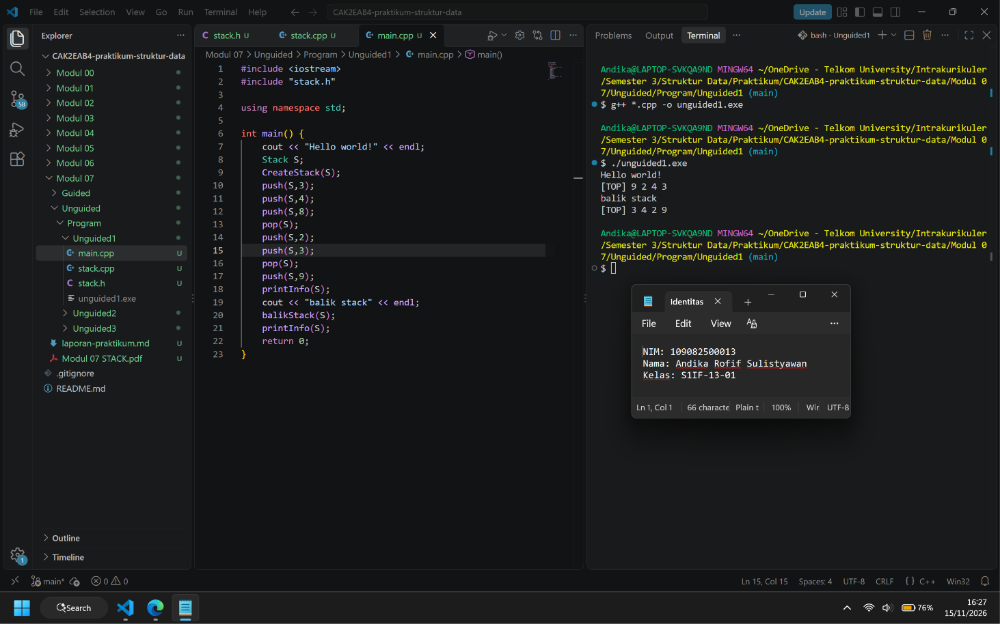
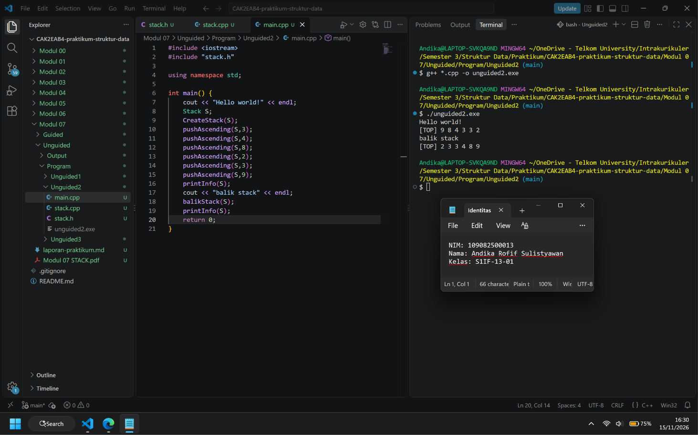
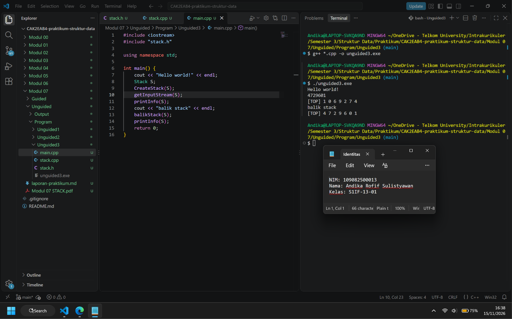
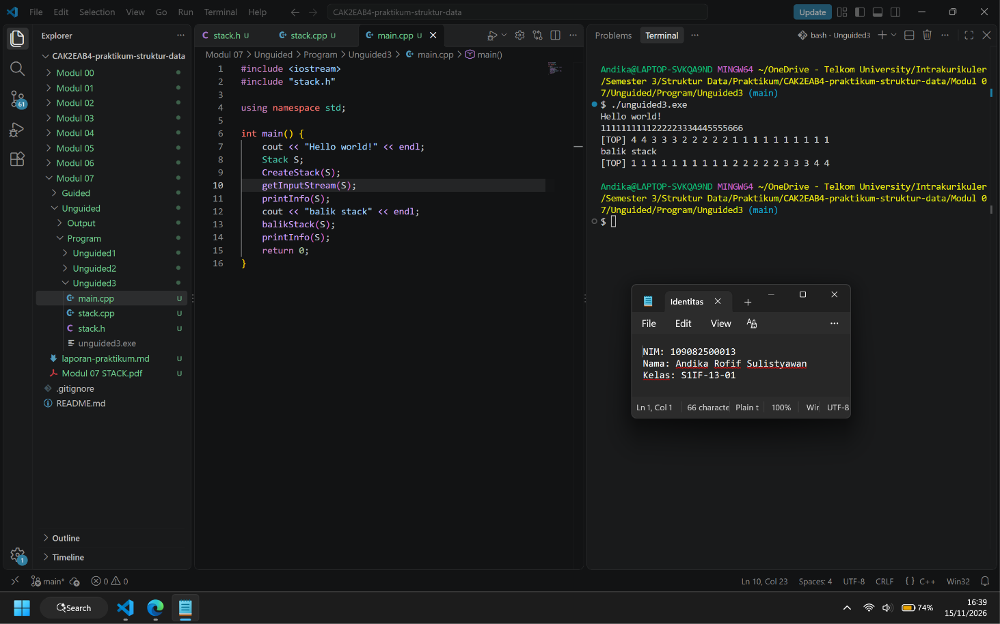
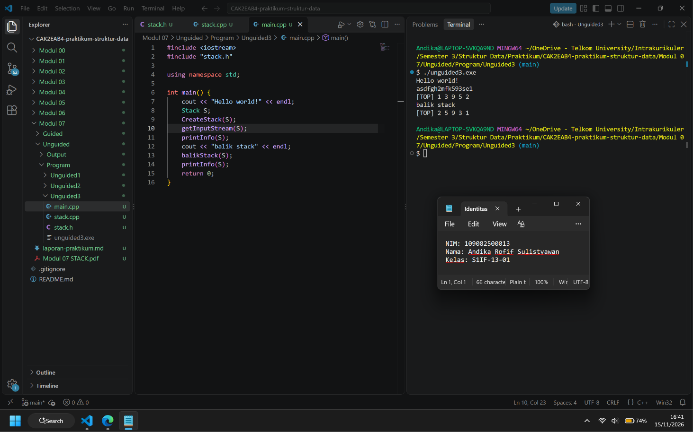

# <h1 align="center">Laporan Praktikum Modul 7 - Stack</h1>
<p align="center">Andika Rofif Sulistyawan - 109082500013</p>

# Dasar Teori

### A. Struktur Data
Struktur data adalah cara untuk mengorganisasi dan menyimpan data agar data dapat diakses serta dikelola sesuai kebutuhan. Pemilihan struktur data memengaruhi cara penyimpanan, pengaksesan, penambahan, dan penghapusan elemen. Array menyimpan elemen pada lokasi memori yang berurutan sehingga elemen dapat diakses melalui indeks

### B. Abstract Data Type (ADT)
Abstract Data Type (ADT) adalah model yang menjelaskan jenis data, karakteristik data, dan operasi yang dapat dilakukan terhadap data tanpa mengharuskan pengguna mengetahui detail implementasinya. ADT memisahkan antarmuka operasi dari cara operasi tersebut diwujudkan

### C. Struktur Data Stack
#### 1. Pengertian Stack
Stack atau tumpukan merupakan salah satu jenis struktur data linear yang digunakan untuk menyimpan sekumpulan elemen dengan aturan penambahan dan penghapusan data hanya dilakukan pada satu ujung, yaitu bagian paling atas yang disebut top. Stack menerapkan prinsip LIFO (Last In, First Out), yang berarti data yang terakhir dimasukkan akan menjadi data pertama yang dikeluarkan. Prinsip tersebut dapat diilustrasikan melalui tumpukan piring, yaitu piring yang terakhir diletakkan di bagian atas akan menjadi piring pertama yang diambil. Stack banyak digunakan dalam berbagai proses komputasi, seperti pengolahan ekspresi matematika, manajemen memori, serta fitur undo dan redo pada aplikasi [1][2]

#### 2. Representasi Stack Menggunakan Array
Salah satu cara untuk mengimplementasikan stack adalah menggunakan array atau larik. Setiap elemen array dapat diakses melalui indeks, yang pada bahasa C++ dimulai dari indeks 0. Dalam implementasi stack menggunakan array, diperlukan variabel `top` untuk mencatat posisi atau jumlah elemen yang tersimpan di dalam stack. Jika nilai `top` adalah 0, stack berada dalam kondisi kosong. Ketika elemen ditambahkan, data disimpan pada indeks `top`, kemudian nilai `top` bertambah satu. Sebaliknya, ketika elemen dihapus, nilai `top` berkurang satu sehingga elemen yang berada di posisi teratas tidak lagi dianggap sebagai bagian dari stack. Penggunaan array memiliki keterbatasan berupa kapasitas penyimpanan yang bersifat tetap, sehingga jumlah elemen yang dapat dimasukkan tidak boleh melebihi ukuran array yang telah ditentukan [1][2]

#### 3. Operasi Dasar Stack
Stack memiliki beberapa operasi dasar yang digunakan untuk mengelola elemen di dalamnya. Operasi `CreateStack` digunakan untuk membuat stack kosong dengan menginisialisasi nilai `top` menjadi 0. Operasi `isEmpty` digunakan untuk memeriksa apakah stack kosong, sedangkan `isFull` digunakan untuk memeriksa apakah seluruh kapasitas stack telah terisi. Operasi `push` berfungsi menambahkan elemen baru ke bagian paling atas stack selama kapasitas masih tersedia. Sebaliknya, operasi `pop` digunakan untuk mengambil atau menghapus elemen paling atas dan mengembalikan nilainya. Selain itu, terdapat operasi penampilan data seperti `printInfo` atau `viewStack` yang digunakan untuk menampilkan seluruh elemen stack, umumnya dimulai dari posisi teratas hingga elemen terbawah. Setiap operasi tersebut perlu memperhatikan kondisi stack agar tidak terjadi *overflow*, yaitu penambahan data ketika stack penuh, maupun *underflow*, yaitu pengambilan data ketika stack kosong [2]

#### 4. Pengembangan Operasi pada Stack
Selain operasi dasar, stack dapat dikembangkan dengan menambahkan prosedur yang memiliki fungsi pengolahan data tertentu. Salah satunya adalah prosedur untuk membalik urutan elemen stack. Proses pembalikan dapat dilakukan dengan menukar elemen pada kedua ujung array secara berulang, yaitu elemen terbawah dengan elemen teratas, kemudian bergerak menuju bagian tengah hingga seluruh urutan berubah. Stack juga dapat dikembangkan dengan prosedur `pushAscending`, yaitu operasi penambahan elemen yang mempertahankan urutan data secara menaik (*ascending*). Prosedur ini dilakukan dengan membandingkan elemen baru terhadap elemen yang sudah tersimpan, menggeser elemen yang nilainya lebih besar satu posisi ke kanan, kemudian menempatkan elemen baru pada posisi yang sesuai. Dengan demikian, elemen stack tetap tersusun dari nilai terkecil di bagian bawah hingga nilai terbesar di bagian atas. Pengolahan tersebut merupakan operasi tambahan yang dapat dibuat sesuai kebutuhan, di luar operasi dasar stack

## Guided 

### 1. Guided 1: Abstract Data Type untuk Stack Data Mahasiswa

**`stack.h`**
```h
/* file : stack.h
   contoh ADT stack dengan representasi tabel */
#ifndef STACK_H_INCLUDED
#define STACK_H_INCLUDED

#include <iostream>
using namespace std;

struct infotype {
    char nim[20];
    char nama[20];
};
struct Stack {
    infotype info[10];
    int Top;
};

/* prototype */
/******** pengecekan apakah Stack kosong *********/
int isEmpty(Stack S);
/* mengembalikan nilai 0 jika stack kosong */

/******** pembuatan Stack ********/
void createStack(Stack &S);
/* I.S. sembarang
   F.S. terbentuk stack dengan Top=0 */

/******** penambahan elemen pada Stack ********/
void push(Stack &S, infotype X);
/* I.S. Stack mungkin kosong
   F.S. menambahkan elemen pada stack dengan nilai X, TOP=TOP+1 */

/******** penghapusan elemen pada Stack ********/
void pop(Stack &S, infotype &X);
/* I.S. stack tidak kosong
   F.S. nilai info pada indeks TOP disimpan pada X, kemudian TOP=TOP-1 */

/******** proses semua elemen Stack *********/
void viewStack(Stack S);
/* I.S. stack mungkin kosong
   F.S. jika stack tidak kosong menampilkan semua info yang ada pada stack
*/
#endif // STACK_H_INCLUDED
```

**`stack.cpp`**
```C++
#include "stack.h"

int isEmpty(Stack S) {
    /* Top = 0 berarti kosong, sesuai komentar di stack.h dikembalikan 0 */
    if (S.Top == 0) {
        return 0;
    } else {
        return 1;
    }
}

void createStack(Stack &S) {
    S.Top = 0;
}

void push(Stack &S, infotype X) {
    if (S.Top < 10) {
        S.Top = S.Top + 1;
        S.info[S.Top - 1] = X;   /* Top 1..10 dipetakan ke indeks array 0..9 */
    } else {
        cout << "Stack penuh, data tidak bisa ditambahkan" << endl;
    }
}

void pop(Stack &S, infotype &X) {
    if (isEmpty(S) != 0) {
        X = S.info[S.Top - 1];
        S.Top = S.Top - 1;
    } else {
        cout << "Stack kosong, tidak ada data yang bisa diambil" << endl;
    }
}

void viewStack(Stack S) {
    if (isEmpty(S) == 0) {
        cout << "Stack kosong" << endl;
    } else {
        cout << "Isi stack (dari TOP):" << endl;
        for (int i = S.Top; i >= 1; i--) {
            cout << i << ". " << S.info[i - 1].nim << " - "
                 << S.info[i - 1].nama << endl;
        }
    }
}
```

**`main.cpp`**
```C++
#include <iostream>
#include <cstring>
#include "stack.h"
using namespace std;

int main() {
    Stack S;
    infotype data, hasil;

    createStack(S);
    cout << "Stack baru dibuat, Top = " << S.Top << endl;
    viewStack(S);

    cout << endl << "--- Push 3 data ---" << endl;
    strcpy(data.nim, "103112400001");
    strcpy(data.nama, "Andi");
    push(S, data);

    strcpy(data.nim, "103112400002");
    strcpy(data.nama, "Budi");
    push(S, data);

    strcpy(data.nim, "103112400003");
    strcpy(data.nama, "Citra");
    push(S, data);
    viewStack(S);

    cout << endl << "--- Pop 1 data ---" << endl;
    pop(S, hasil);
    cout << "Data yang diambil: " << hasil.nim << " - " << hasil.nama << endl;
    viewStack(S);

    cout << endl << "--- Pop sampai kosong ---" << endl;
    pop(S, hasil);
    pop(S, hasil);
    pop(S, hasil);
    viewStack(S);

    return 0;
}
```

Program di atas merupakan implementasi Abstract Data Type (ADT) Stack yang digunakan untuk menyimpan data mahasiswa berupa NIM dan nama. Stack memiliki kapasitas maksimal 10 data dan menerapkan prinsip LIFO (Last In, First Out), sehingga data mahasiswa yang terakhir dimasukkan akan menjadi data pertama yang dikeluarkan. Program menyediakan operasi untuk membuat stack, memeriksa kondisi stack, menambahkan data (push), mengeluarkan data (pop), serta menampilkan seluruh isi stack

File `stack.h` mendefinisikan struktur `infotype` yang berisi array karakter `nim` dan `nama`, serta struktur `Stack` yang memiliki array `info[10]` dan variabel `Top`. File `stack.cpp` berisi implementasi seluruh operasi stack, yaitu `isEmpty` untuk memeriksa apakah stack kosong, `createStack` untuk menginisialisasi stack, `push` untuk menambahkan data mahasiswa, `pop` untuk mengambil data teratas, dan `viewStack` untuk menampilkan isi stack dari posisi teratas. Sementara itu, `main.cpp` berfungsi sebagai program utama yang menguji operasi-operasi tersebut dengan membuat stack kosong, memasukkan tiga data mahasiswa bernama Andi, Budi, dan Citra, kemudian mengeluarkan data secara bertahap hingga stack kembali kosong. Hasil pengujian menunjukkan bahwa data Citra dikeluarkan terlebih dahulu, kemudian Budi, dan terakhir Andi, sesuai dengan prinsip LIFO

## Unguided

### 1. Unguided 1: Abstract Data Type untuk Stack Bilangan
#### Soal
Buatlah ADT Stack menggunakan ARRAY sebagai berikut di dalam file "stack.h":
```text
Type infotype : integer 
Type Stack <
    info : array [20] of integer
    top : integer
>
procedure CreateStack( input/output S : Stack )
procedure push( input/output S : Stack, input x : infotype )
function pop( input/output S : Stack ) → infotype
procedure printInfo( input S : Stack )
procedure balikStack( input/output S : Stack )
```

Buatlah implementasi ADT Stack menggunakan Array pada file "stack.cpp" dan "main.cpp"
```C++
int main()
{ 
    cout << "Hello world!" << endl;
    Stack S;
    CreateStack(S);
    push(S,3);
    push(S,4);
    push(S,8);
    pop(S)
    push(S,2);
    push(S,3);
    pop(S);
    push(S,9);
    printInfo(S);
    cout << "balik stack" << endl;
    balikStack(S);
    printInfo(S);
    return 0; 
} 
```

#### Jawaban
**`stack.h`**
```h
#ifndef STACK_H
#define STACK_H

typedef int infotype;
struct Stack {
    infotype info[20];
    int top;
};

// I.S.: stack belum diinisialisasi
// F.S.: terbentuk stack kosong dengan top = 0
void CreateStack(Stack &S);

// mengembalikan true jika stack kosong, atau false jika stack tidak kosong
bool isEmpty(Stack S);

// mengembalikan true jika stack penuh, atau false jika stack belum penuh
bool isFull(Stack S);

// I.S.: stack mungkin kosong atau tidak penuh
// F.S.: elemen x ditambahkan ke posisi top, kemudian top bertambah 1
void push(Stack &S, infotype x);

// I.S.: stack tidak kosong
// F.S.: elemen paling atas diambil dan top berkurang 1
// Return: nilai elemen yang sebelumnya berada di top. Mengembalikan 0 jika stack kosong
infotype pop(Stack &S);

// I.S.: stack mungkin kosong atau berisi elemen
// F.S.: seluruh elemen stack ditampilkan dari top hingga elemen terbawah
void printInfo(Stack S);

// I.S.: stack mungkin kosong atau berisi elemen
// F.S.: urutan seluruh elemen stack dibalik
void balikStack(Stack &S);

#endif
```

**`stack.cpp`**
```C++
#include <iostream>
#include "stack.h"

void CreateStack(Stack &S) {
    S.top = 0;
}

bool isEmpty(Stack S) {
    return S.top == 0;
}

bool isFull(Stack S) {
    return S.top == 20;
}

void push(Stack &S, infotype x) {
    if (isFull(S)) {
        std::cout << "Stack penuh" << std::endl;
    } else {
        S.info[S.top] = x;
        S.top++;
    }
}

infotype pop(Stack &S) {
    if (isEmpty(S)) {
        std::cout << "Stack kosong" << std::endl;
        return 0;
    } else {
        S.top--;
        return S.info[S.top];
    }
}

void printInfo(Stack S) {
    if (isEmpty(S)) {
        std::cout << "Stack kosong" << std::endl;
    } else {
        std::cout << "[TOP] ";

        for (int i = S.top - 1; i >= 0; i--) {
            std::cout << S.info[i] << " ";
        }

        std::cout << std::endl;
    }
}

void balikStack(Stack &S) {
    int kiri = 0;
    int kanan = S.top - 1;
    int temp;

    while (kiri < kanan) {
        temp = S.info[kiri];
        S.info[kiri] = S.info[kanan];
        S.info[kanan] = temp;

        kiri++;
        kanan--;
    }
}
```

**`main.cpp`**
```C++
#include <iostream>
#include "stack.h"

using namespace std;

int main() {
    cout << "Hello world!" << endl;
    Stack S;
    CreateStack(S);
    push(S,3);
    push(S,4);
    push(S,8);
    pop(S);
    push(S,2);
    push(S,3);
    pop(S);
    push(S,9);
    printInfo(S);
    cout << "balik stack" << endl;
    balikStack(S);
    printInfo(S);
    return 0;
}
```
#### Output Unguided 1 :

##### Output 1


Program di atas merupakan implementasi Abstract Data Type (ADT) Stack untuk menyimpan dan mengelola sekumpulan bilangan bulat dengan menggunakan array berukuran maksimal 20 elemen. Stack menerapkan prinsip LIFO (Last In, First Out), yaitu data yang terakhir dimasukkan akan menjadi data pertama yang dikeluarkan. Program tersebut menyediakan operasi dasar stack, yaitu membuat stack, menambahkan data (push), mengeluarkan data (pop), memeriksa kondisi stack, menampilkan isi stack, dan membalik urutan elemen stack

File `stack.h` berfungsi sebagai header yang mendefinisikan struktur data dan deklarasi fungsi serta prosedur yang digunakan dalam program. Terdapat `typedef int infotype` untuk menentukan bahwa tipe data elemen stack adalah bilangan bulat, serta `struct Stack` yang memiliki array `info[20]` untuk menyimpan elemen dan variabel `top` untuk menunjukkan posisi elemen teratas. File tersebut juga memuat deklarasi prosedur `CreateStack`, `push`, `printInfo`, dan `balikStack`, serta deklarasi fungsi `isEmpty`, `isFull`, dan `pop` yang digunakan untuk mengelola isi stack

File `stack.cpp` berisi implementasi dari seluruh fungsi dan prosedur yang telah dideklarasikan pada `stack.h`. Prosedur `CreateStack` digunakan untuk menginisialisasi stack dengan mengatur nilai `top` menjadi 0. Fungsi `isEmpty` dan `isFull` digunakan untuk memeriksa apakah stack kosong atau penuh. Prosedur `push` menambahkan elemen baru ke posisi teratas stack selama kapasitasnya belum penuh, sedangkan fungsi `pop` mengeluarkan elemen teratas dan mengembalikan nilainya. Prosedur `printInfo` menampilkan seluruh elemen stack dimulai dari posisi teratas hingga terbawah. Sementara itu, prosedur `balikStack` membalik urutan elemen dengan menukar elemen dari kedua ujung array secara bertahap hingga mencapai bagian tengah

File `main.cpp` berfungsi sebagai program utama yang menjalankan operasi-operasi stack. Pertama, program membuat stack kosong menggunakan prosedur `CreateStack`, kemudian memasukkan bilangan 3, 4, dan 8 menggunakan operasi `push`. Setelah itu, program melakukan operasi `pop` untuk mengeluarkan elemen teratas, yaitu 8, kemudian memasukkan bilangan 2 dan 3, melakukan `pop` kembali untuk mengeluarkan bilangan 3, dan memasukkan bilangan 9. Selanjutnya, program menampilkan isi stack menggunakan `printInfo`, sehingga urutan elemen dari posisi teratas adalah 9, 2, 4, dan 3. Program kemudian menampilkan keterangan "balik stack", menjalankan prosedur `balikStack`, dan kembali menampilkan isi stack. Setelah dibalik, urutan elemen dari posisi teratas menjadi 3, 4, 2, dan 9

### 2. Unguided 2: Penambahan Prosedur pushAscending pada ADT Sebelumnya
#### Soal
Tambahkan prosedur pushAscending( in/out S : Stack, in x : integer)
```C++
int main()
{
    cout << "Hello world!" << endl;
    Stack S;
    CreateStack(S);
    pushAscending(S,3);
    pushAscending(S,4);
    pushAscending(S,8);
    pushAscending(S,2);
    pushAscending(S,3);
    pushAscending(S,9);
    printInfo(S);
    cout << "balik stack" << endl;
    balikStack(S);
    printInfo(S);
    return 0;
}
```

#### Jawaban
**`stack.h`**
```h
#ifndef STACK_H
#define STACK_H

typedef int infotype;
struct Stack {
    infotype info[20];
    int top;
};

// I.S.: stack belum diinisialisasi
// F.S.: terbentuk stack kosong dengan top = 0
void CreateStack(Stack &S);

// mengembalikan true jika stack kosong, atau false jika stack tidak kosong
bool isEmpty(Stack S);

// mengembalikan true jika stack penuh, atau false jika stack belum penuh
bool isFull(Stack S);

// I.S.: stack mungkin kosong atau tidak penuh
// F.S.: elemen x ditambahkan ke posisi top, kemudian top bertambah 1
void push(Stack &S, infotype x);

// I.S.: stack tidak kosong
// F.S.: elemen paling atas diambil dan top berkurang 1
// Return: nilai elemen yang sebelumnya berada di top. Mengembalikan 0 jika stack kosong
infotype pop(Stack &S);

// I.S.: stack mungkin kosong atau berisi elemen
// F.S.: seluruh elemen stack ditampilkan dari top hingga elemen terbawah
void printInfo(Stack S);

// I.S.: stack mungkin kosong atau berisi elemen
// F.S.: urutan seluruh elemen stack dibalik
void balikStack(Stack &S);

// I.S.: stack mungkin kosong atau berisi elemen
// F.S.: elemen x dimasukkan ke stack sehingga urutan elemen dari bawah ke atas tetap ascending
void pushAscending(Stack &S, int x);

#endif
```

**`stack.cpp`**
```C++
#include <iostream>
#include "stack.h"

void CreateStack(Stack &S) {
    S.top = 0;
}

bool isEmpty(Stack S) {
    return S.top == 0;
}

bool isFull(Stack S) {
    return S.top == 20;
}

void push(Stack &S, infotype x) {
    if (isFull(S)) {
        std::cout << "Stack penuh" << std::endl;
    } else {
        S.info[S.top] = x;
        S.top++;
    }
}

infotype pop(Stack &S) {
    if (isEmpty(S)) {
        std::cout << "Stack kosong" << std::endl;
        return 0;
    } else {
        S.top--;
        return S.info[S.top];
    }
}

void printInfo(Stack S) {
    if (isEmpty(S)) {
        std::cout << "Stack kosong" << std::endl;
    } else {
        std::cout << "[TOP] ";

        for (int i = S.top - 1; i >= 0; i--) {
            std::cout << S.info[i] << " ";
        }

        std::cout << std::endl;
    }
}

void balikStack(Stack &S) {
    int kiri = 0;
    int kanan = S.top - 1;
    int temp;

    while (kiri < kanan) {
        temp = S.info[kiri];
        S.info[kiri] = S.info[kanan];
        S.info[kanan] = temp;

        kiri++;
        kanan--;
    }
}

void pushAscending(Stack &S, int x) {
    if (isFull(S)) {
        std::cout << "Stack penuh" << std::endl;
    } else {
        int i = S.top - 1;
        while (i >= 0 && S.info[i] > x) {
            S.info[i + 1] = S.info[i];
            i--;
        }
    
        S.info[i + 1] = x;
        S.top++;
    }
}
```
**`main.cpp`**
```C++
#include <iostream>
#include "stack.h"

using namespace std;

int main() {
    cout << "Hello world!" << endl;
    Stack S;
    CreateStack(S);
    pushAscending(S,3);
    pushAscending(S,4);
    pushAscending(S,8);
    pushAscending(S,2);
    pushAscending(S,3);
    pushAscending(S,9);
    printInfo(S);
    cout << "balik stack" << endl;
    balikStack(S);
    printInfo(S);
    return 0;
}
```

#### Output Unguided 2 :

##### Output 2


Program di atas merupakan pengembangan dari program ADT Stack pada Unguided 1 dengan menambahkan prosedur `pushAscending`. Penambahan prosedur tersebut bertujuan agar setiap elemen yang dimasukkan ke dalam stack selalu tersusun secara ascending atau menaik, dimulai dari elemen terbawah hingga elemen teratas. Bagian program sebelumnya tetap dipertahankan, seperti struktur data Stack, operasi dasar `push` dan `pop`, prosedur `printInfo`, serta prosedur `balikStack`. Perbedaan utamanya terletak pada cara memasukkan elemen, yaitu menggunakan `pushAscending` sebagai pengganti `push`

Pada file `stack.h`, deklarasi struktur Stack dan fungsi serta prosedur dari program sebelumnya tetap dipertahankan. Perubahan yang ditambahkan adalah deklarasi prosedur `pushAscending(Stack &S, int x)` beserta keterangan I.S. dan F.S.-nya. Prosedur tersebut menerima parameter `S` sebagai stack yang akan diubah dan `x` sebagai bilangan bulat yang akan dimasukkan

Pada file `stack.cpp`, bagian implementasi program sebelumnya tetap digunakan, kemudian ditambahkan implementasi prosedur `pushAscending`. Prosedur tersebut terlebih dahulu memeriksa apakah stack sudah penuh menggunakan fungsi `isFull`. Jika stack penuh, program menampilkan pesan "Stack penuh". Jika masih tersedia ruang, variabel `i` diatur ke posisi elemen teratas, yaitu `S.top - 1`. Selanjutnya, perulangan `while` digunakan untuk menggeser elemen yang nilainya lebih besar dari `x` satu posisi ke kanan. Setelah menemukan posisi yang sesuai, nilai `x` dimasukkan ke `S.info[i + 1]`, kemudian nilai `S.top` ditambah satu

Pada file `main.cpp`, perubahan utama terdapat pada penggunaan prosedur `pushAscending` untuk memasukkan seluruh bilangan, yaitu 3, 4, 8, 2, 3, dan 9. Berbeda dengan program sebelumnya yang menggunakan `push`, seluruh elemen pada program tersebut akan langsung diatur berdasarkan urutan ascending setiap kali dimasukkan. Setelah semua elemen dimasukkan, prosedur `printInfo` digunakan untuk menampilkan isi stack dari posisi teratas hingga terbawah, sehingga menghasilkan urutan `[TOP] 9 8 4 3 3 2`. Selanjutnya, program menjalankan prosedur `balikStack` untuk membalik urutan elemen dan menampilkannya kembali. Hasil akhirnya adalah `[TOP] 2 3 3 4 8 9`

### 3. Unguided 3: Penambahan Prosedur getInputStream pada ADT Sebelumnya
#### Soal
Tambahkan prosedur getInputStream( in/out S : Stack ). Prosedur akan terus membaca dan menerima input user dan memasukkan setiap input ke dalam stack hingga user menekan tombol enter. Contoh: gunakan cin.get() untuk mendapatkan inputan user.
```C++
int main()
{
    cout << "Hello world!" << endl;
    Stack S;
    CreateStack(S);
    getInputStream(S);
    printInfo(S);
    cout << "balik stack" << endl;
    balikStack(S);
    printInfo(S);
    return 0;
}
```

#### Jawaban
**`stack.h`**
```h
#ifndef STACK_H
#define STACK_H

typedef int infotype;
struct Stack {
    infotype info[20];
    int top;
};

// I.S.: stack belum diinisialisasi
// F.S.: terbentuk stack kosong dengan top = 0
void CreateStack(Stack &S);

// mengembalikan true jika stack kosong, atau false jika stack tidak kosong
bool isEmpty(Stack S);

// mengembalikan true jika stack penuh, atau false jika stack belum penuh
bool isFull(Stack S);

// I.S.: stack mungkin kosong atau tidak penuh
// F.S.: elemen x ditambahkan ke posisi top, kemudian top bertambah 1
void push(Stack &S, infotype x);

// I.S.: stack tidak kosong
// F.S.: elemen paling atas diambil dan top berkurang 1
// Return: nilai elemen yang sebelumnya berada di top. Mengembalikan 0 jika stack kosong
infotype pop(Stack &S);

// I.S.: stack mungkin kosong atau berisi elemen
// F.S.: seluruh elemen stack ditampilkan dari top hingga elemen terbawah
void printInfo(Stack S);

// I.S.: stack mungkin kosong atau berisi elemen
// F.S.: urutan seluruh elemen stack dibalik
void balikStack(Stack &S);

// I.S.: stack mungkin kosong atau berisi elemen
// F.S.: elemen x dimasukkan ke stack sehingga urutan elemen dari bawah ke atas tetap ascending
void pushAscending(Stack &S, int x);

// I.S.: stack mungkin kosong atau berisi elemen
// F.S.: input angka dari pengguna dimasukkan ke stack sampai pengguna menekan tombol Enter
void getInputStream(Stack &S);

#endif
```

**`stack.cpp`**
```C++
#include <iostream>
#include <cctype>
#include "stack.h"

void CreateStack(Stack &S) {
    S.top = 0;
}

bool isEmpty(Stack S) {
    return S.top == 0;
}

bool isFull(Stack S) {
    return S.top == 20;
}

void push(Stack &S, infotype x) {
    if (isFull(S)) {
        std::cout << "Stack penuh" << std::endl;
    } else {
        S.info[S.top] = x;
        S.top++;
    }
}

infotype pop(Stack &S) {
    if (isEmpty(S)) {
        std::cout << "Stack kosong" << std::endl;
        return 0;
    } else {
        S.top--;
        return S.info[S.top];
    }
}

void printInfo(Stack S) {
    if (isEmpty(S)) {
        std::cout << "Stack kosong" << std::endl;
    } else {
        std::cout << "[TOP] ";

        for (int i = S.top - 1; i >= 0; i--) {
            std::cout << S.info[i] << " ";
        }

        std::cout << std::endl;
    }
}

void balikStack(Stack &S) {
    int kiri = 0;
    int kanan = S.top - 1;
    int temp;

    while (kiri < kanan) {
        temp = S.info[kiri];
        S.info[kiri] = S.info[kanan];
        S.info[kanan] = temp;

        kiri++;
        kanan--;
    }
}

void pushAscending(Stack &S, int x) {
    if (isFull(S)) {
        std::cout << "Stack penuh" << std::endl;
    } else {
        int i = S.top - 1;
        while (i >= 0 && S.info[i] > x) {
            S.info[i + 1] = S.info[i];
            i--;
        }
    
        S.info[i + 1] = x;
        S.top++;
    }
}

void getInputStream(Stack &S) {
    char karakter;

    while (std::cin.get(karakter) && karakter != '\n' && !isFull(S)) {
        if (std::isdigit(static_cast<unsigned char>(karakter))) {
            push(S, karakter - '0');
        }
    }
}
```

**`main.cpp`**
```C++
#include <iostream>
#include "stack.h"

using namespace std;

int main() {
    cout << "Hello world!" << endl;
    Stack S;
    CreateStack(S);
    getInputStream(S);
    printInfo(S);
    cout << "balik stack" << endl;
    balikStack(S);
    printInfo(S);
    return 0;
} 
```
#### Output Unguided 3 :

##### Output 1


##### Output 2


##### Output 3


Program di atas merupakan pengembangan dari ADT Stack pada Unguided 2 dengan menambahkan prosedur `getInputStream`. Prosedur tersebut memungkinkan pengguna memasukkan sejumlah angka melalui keyboard hingga menekan tombol Enter. Struktur dan operasi stack dari soal sebelumnya tetap dipertahankan, termasuk prosedur `pushAscending`, meskipun pada program utama kali ini prosedur tersebut tidak digunakan

Pada file `stack.h`, seluruh deklarasi struktur, fungsi, dan prosedur dari soal sebelumnya tetap dipertahankan. Perubahan yang ditambahkan adalah deklarasi prosedur `getInputStream(Stack &S)` beserta keterangan I.S. dan F.S.-nya. Prosedur tersebut menerima parameter `S` sebagai stack yang akan diisi berdasarkan input pengguna. Kondisi akhirnya adalah setiap karakter angka yang diterima dimasukkan ke dalam stack hingga pengguna menekan tombol Enter atau kapasitas stack sudah penuh

Pada file `stack.cpp`, implementasi seluruh fungsi dan prosedur sebelumnya tetap dipertahankan, kemudian ditambahkan implementasi prosedur `getInputStream`. Prosedur tersebut menggunakan variabel `karakter` bertipe `char` untuk menampung setiap karakter yang dibaca melalui `std::cin.get(karakter)`. Perulangan `while` akan terus berjalan selama input berhasil dibaca, karakter bukan `'\n'` (Enter), dan stack belum penuh. Di dalam perulangan, `std::isdigit(static_cast<unsigned char>(karakter))` digunakan untuk memeriksa apakah karakter yang dimasukkan merupakan angka. Jika karakter tersebut berupa angka, nilai `karakter - '0'` digunakan untuk mengubah karakter angka menjadi bilangan bulat, kemudian dimasukkan ke dalam stack menggunakan prosedur `push`. Dengan demikian, setiap digit dimasukkan sebagai satu elemen stack. Sebagai contoh, jika pengguna memasukkan `4729601`, stack akan menyimpan tujuh elemen, yaitu 4, 7, 2, 9, 6, 0, dan 1

Pada file `main.cpp`, perubahan utama terdapat pada penggunaan prosedur `getInputStream(S)` sebagai pengganti pemanggilan `pushAscending` secara berulang. Setelah stack diinisialisasi menggunakan `CreateStack(S)`, program memanggil `getInputStream(S)` agar pengguna dapat memasukkan angka melalui keyboard. Setelah pengguna menekan Enter, isi stack ditampilkan menggunakan `printInfo(S)`. Selanjutnya, program menjalankan prosedur `balikStack(S)` untuk membalik urutan elemen dan kembali menampilkannya menggunakan `printInfo(S)`

## Kesimpulan
Stack merupakan salah satu struktur data linear yang menerapkan prinsip LIFO (Last In, First Out), yaitu elemen yang terakhir dimasukkan akan menjadi elemen pertama yang dikeluarkan. Dalam implementasinya menggunakan bahasa C++, stack dapat direpresentasikan menggunakan array dengan variabel top untuk menunjukkan posisi elemen teratas. Penggunaan Abstract Data Type (ADT) membuat program lebih terstruktur karena deklarasi struktur data, fungsi, dan prosedur dipisahkan dari implementasinya. Beberapa operasi dasar yang digunakan meliputi pembuatan stack, pemeriksaan kondisi stack, penambahan elemen (push), penghapusan elemen (pop), serta penampilan seluruh isi stack.

Pengelolaan data pada stack dilakukan dengan memperhatikan posisi top dan kapasitas penyimpanan agar proses penambahan maupun penghapusan elemen berjalan dengan benar. Selain operasi dasar, stack dapat dikembangkan melalui prosedur tambahan, seperti balikStack untuk membalik urutan elemen dan pushAscending untuk memasukkan elemen dengan mempertahankan urutan menaik. Input dari pengguna juga dapat diproses menggunakan cin.get() sehingga setiap karakter angka dapat dibaca dan dimasukkan ke dalam stack hingga pengguna menekan tombol Enter. Elemen stack tidak hanya berupa bilangan, melainkan juga dapat menggunakan tipe data bentukan struct untuk menyimpan beberapa atribut sekaligus, seperti NIM dan nama mahasiswa

## Referensi

[1] Sihombing, J. (2019). "Penerapan Stack dan Queue pada Array dan Linked List dalam Java." *INFOKOM (Informatika & Komputer)*, 7(2), 15–24. Diakses melalui [https://journal.piksi.ac.id/index.php/INFOKOM/article/view/160](https://journal.piksi.ac.id/index.php/INFOKOM/article/view/160).<br>
[2] Setiyawan, R. D., Hermawan, D., Abdillah, A. F., Mujayanah, A., & Vindua, R. (2024). "Penggunaan Struktur Data Stack dalam Pemrograman C++ dengan Pendekatan Array dan Linked List." *JUTECH: Journal Education and Technology*, 5(2), 484–498. Diakses melalui [https://doi.org/10.31932/jutech.v5i2.4263](https://doi.org/10.31932/jutech.v5i2.4263).<br>