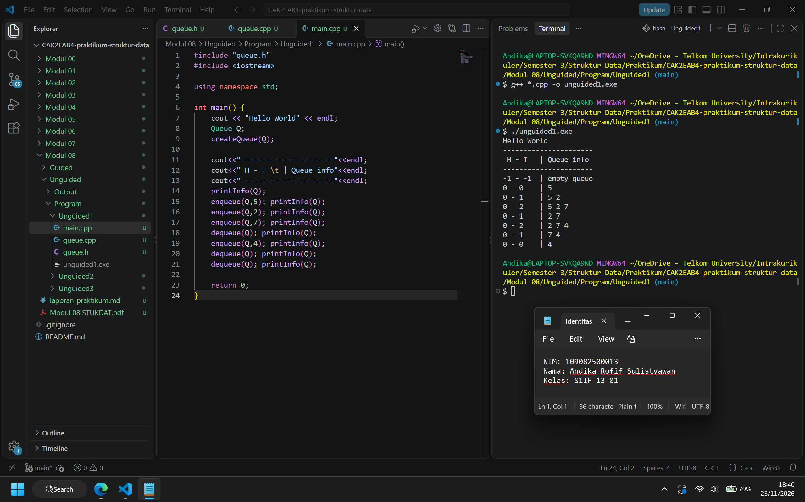
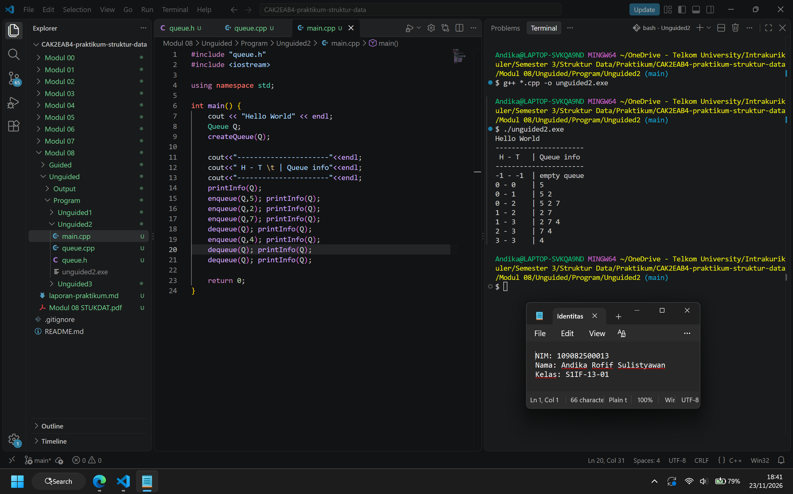
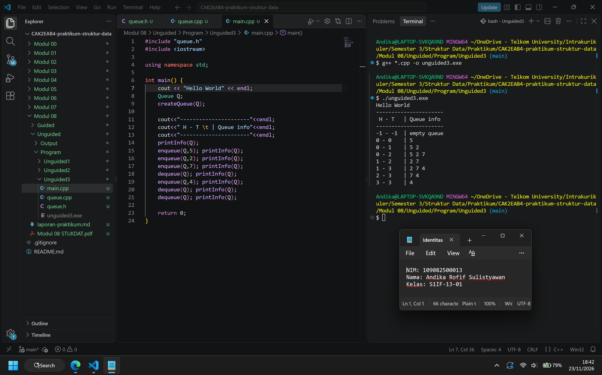

# <h1 align="center">Laporan Praktikum Modul 8 - Queue</h1>
<p align="center">Andika Rofif Sulistyawan - 109082500013</p>

## Dasar Teori
### A. Struktur Data Queue<br/>

#### 1. Pengertian Queue
Queue merupakan salah satu struktur data linear yang digunakan untuk menyimpan sekumpulan elemen secara berurutan. Queue menerapkan prinsip FIFO (First In, First Out), yaitu elemen yang pertama kali dimasukkan akan menjadi elemen pertama yang dikeluarkan. Proses penambahan elemen dilakukan pada bagian belakang antrean, sedangkan penghapusan dilakukan pada bagian depan antrean. Dalam penerapannya, queue dapat digunakan untuk merepresentasikan sistem antrean, penjadwalan proses, serta pengelolaan data yang perlu diproses berdasarkan urutan kedatangan[1][2]

#### 2. Operasi Dasar Queue
Queue memiliki beberapa operasi dasar untuk mengelola elemen di dalamnya. Operasi `CreateQueue` digunakan untuk membentuk queue dalam keadaan kosong. Operasi `isEmptyQueue` digunakan untuk memeriksa apakah queue tidak memiliki elemen, sedangkan `isFullQueue` digunakan untuk memeriksa apakah kapasitas queue telah terpenuhi. Operasi `enqueue` berfungsi menambahkan elemen baru ke bagian belakang queue, sementara `dequeue` digunakan untuk mengambil sekaligus menghapus elemen yang berada di bagian depan. Selain itu, operasi `printInfo` digunakan untuk menampilkan elemen-elemen yang tersimpan di dalam queue

#### 3. Representasi Queue Menggunakan Singly Linked List
Queue dapat direpresentasikan menggunakan singly linked list, yaitu kumpulan node yang saling terhubung melalui pointer. Setiap node menyimpan informasi berupa data dan pointer `next` yang menunjuk ke node berikutnya. Pada implementasi queue menggunakan singly linked list, pointer `head` menunjuk node pertama yang akan dikeluarkan, sedangkan pointer `tail` menunjuk node terakhir sebagai tempat penambahan elemen. Ketika queue kosong, kedua pointer tersebut bernilai `Nil`. Penambahan elemen dilakukan dengan menghubungkan node baru pada bagian akhir, sedangkan penghapusan dilakukan dengan memindahkan `head` ke node berikutnya dan membebaskan memori node yang dihapus

### B. Implementasi Queue Menggunakan Array<br/>

#### 1. Pengertian dan Karakteristik Queue Array
Selain menggunakan singly linked list, queue dapat diimplementasikan menggunakan array. Array menyimpan elemen pada lokasi yang berurutan dan setiap elemen dapat diakses melalui indeks. Dalam queue berbasis array, variabel `head` digunakan untuk menunjukkan indeks elemen paling depan, sedangkan `tail` menunjukkan indeks elemen paling belakang. Berbeda dengan singly linked list yang dapat menggunakan alokasi memori dinamis, array memiliki kapasitas tetap sesuai ukuran yang ditentukan ketika struktur data dibuat. Oleh karena itu, operasi penambahan harus memeriksa apakah masih tersedia ruang di dalam array[1][2]

#### 2. Queue Linear dengan Head Diam dan Head Bergerak
Pada implementasi queue linear, terdapat pendekatan dengan posisi `head` tetap dan `tail` bergerak, serta pendekatan dengan `head` dan `tail` yang sama-sama bergerak. Pada pendekatan pertama, elemen yang dihapus menyebabkan elemen-elemen setelahnya digeser satu posisi ke kiri agar posisi depan tetap berada pada indeks awal. Sementara itu, pada pendekatan kedua, penghapusan cukup dilakukan dengan menaikkan indeks `head` tanpa menggeser elemen lainnya. Jika `tail` telah mencapai indeks terakhir sementara masih terdapat ruang kosong di bagian awal array, elemen-elemen yang tersisa dapat digeser kembali ke depan ketika operasi penambahan membutuhkan ruang. Kedua pendekatan tersebut tetap menggunakan prinsip FIFO, tetapi memiliki cara pengelolaan indeks dan ruang kosong yang berbeda

#### 3. Queue Circular
Queue circular atau antrean melingkar merupakan pengembangan queue berbasis array yang memungkinkan indeks `head` dan `tail` bergerak secara melingkar. Ketika indeks mencapai posisi terakhir array, indeks berikutnya akan kembali ke posisi pertama dengan memanfaatkan operasi modulus. Dengan cara tersebut, ruang kosong yang terbentuk akibat operasi `dequeue` dapat digunakan kembali tanpa harus menggeser seluruh elemen. Pada implementasi ini, `head` bergerak ketika elemen dihapus, sedangkan `tail` bergerak ketika elemen ditambahkan. Pemeriksaan kondisi penuh dilakukan dengan membandingkan posisi setelah `tail` bergerak satu langkah dengan posisi `head`. Queue circular dapat memanfaatkan kapasitas array secara lebih efisien dibandingkan queue linear yang tidak menggunakan kembali ruang kosong di bagian awal array[2]

## Guided 

### 1. Guided 1: Queue dengan Pointer

**`queue.h`**
```h
#ifndef QUEUE_H_INCLUDE
#define QUEUE_H_INCLUDE

#include <iostream>
using namespace std;

#define Nil NULL
#define boolean bool

typedef int infotype;
typedef struct elmQ *address;

struct elmQ {
    infotype info;
    address next;
};

/* deklarasi tipe data queue, terdiri dari head dan tail, queue kosong jika
   head == Nil */
struct queue {
    address head, tail;
};

/*prototype*/
/********* pengecekan apakah queue kosong ***********/
boolean isEmpty (queue Q);
/*mengembalikan nilai true jika queue kosong*/

/********* pembuatan queue kosong *********/
void CreateQueue (queue &Q);
/* I.S. sembarang
   F.S. terbentuk queue kosong*/

/********* manajemen memori *********/
address alokasi (infotype X);
/* mengirimkan address dari alokasi elemen
   jika alokasi berhasil, maka nilai address tidak Nil dan jika gagal, nilai
   address Nil */

void dealokasi (address P);
/* I.S. P terdefinisi
   F.S. memori yang digunakan P dikembalikan ke sistem */

/********* pencarian sebuah elemen list *********/
address findElm (queue Q, infotype X);
/* mencari apakah ada elemen queue dengan P->info = X
   jika ada, mengembalikan address elemen tsb, dan Nil jika sebaliknya */

boolean fFindElm (queue Q, address P);
/* mencari apakah ada elemen queue dengan alamat P
   mengembalikan true jika ada dan false jika tidak ada */

/********* penambahan elemen **********/
void insert (queue &Q, address P);
/* I.S. sembarang, P sudah dialokasikan
   F.S. menempatkan elemen beralamat P pada akhir queue*/

/********* penghapusan sebuah elemen **********/
void deleteQueue (queue &Q, address &P);
/* I.S. queue tidak kosong
   F.S. menunjuk elemen pertama queue, head dari queue menunjuk pada next
   elemen head yang lama. Queue mungkin menjadi kosong */

/********* proses semua elemen queue**********/
void printInfo (queue Q);
/* I.S. queue mungkin tidak kosong
   F.S. jika queue tidak kosong, maka menampilkan semua info yang ada pada
   queue */

int nbList (queue Q);
/* mengembalikan jumlah elemen pada queue */

void delAll (queue &Q);
/* menghapus semua elemen pada queue dan semua elemen di-dealokasi */

#endif
```

**`queue.cpp`**
```C++
#include "queue.h"

boolean isEmpty(queue Q) {
    return (Q.head == Nil);
}

void CreateQueue(queue &Q) {
    Q.head = Nil;
    Q.tail = Nil;
}

address alokasi(infotype X) {
    address P = new (nothrow) elmQ;
    if (P != Nil) {
        P->info = X;
        P->next = Nil;
    }
    return P;
}

void dealokasi(address P) {
    delete P;
}

address findElm(queue Q, infotype X) {
    address P = Q.head;
    while (P != Nil) {
        if (P->info == X) {
            return P;
        }
        P = P->next;
    }
    return Nil;
}

boolean fFindElm(queue Q, address P) {
    address R = Q.head;
    while (R != Nil) {
        if (R == P) {
            return true;
        }
        R = R->next;
    }
    return false;
}

void insert(queue &Q, address P) {
    if (isEmpty(Q)) {
        Q.head = P;
        Q.tail = P;
    } else {
        (Q.tail)->next = P;
        Q.tail = P;
    }
}

void deleteQueue(queue &Q, address &P) {
    P = Q.head;
    if (Q.head == Q.tail) {
        Q.head = Nil;
        Q.tail = Nil;
    } else {
        Q.head = P->next;
    }
    P->next = Nil;
}

void printInfo(queue Q) {
    if (isEmpty(Q)) {
        cout << "Queue kosong" << endl;
    } else {
        address P = Q.head;
        while (P != Nil) {
            cout << P->info << " ";
            P = P->next;
        }
        cout << endl;
    }
}

int nbList(queue Q) {
    int jumlah = 0;
    address P = Q.head;
    while (P != Nil) {
        jumlah++;
        P = P->next;
    }
    return jumlah;
}

void delAll(queue &Q) {
    address P;
    while (!isEmpty(Q)) {
        deleteQueue(Q, P);
        dealokasi(P);
    }
}
```

**`main.cpp`**
```C++
#include <iostream>
#include "queue.h"
using namespace std;

int main() {
    queue Q;
    address P;

    CreateQueue(Q);
    cout << "isEmpty : " << isEmpty(Q) << endl;
    printInfo(Q);

    insert(Q, alokasi(5));
    insert(Q, alokasi(2));
    insert(Q, alokasi(7));
    cout << "Setelah insert 5, 2, 7" << endl;
    printInfo(Q);
    cout << "nbList  : " << nbList(Q) << endl;

    P = findElm(Q, 2);
    if (P != Nil) {
        cout << "findElm(2) ketemu, info = " << P->info << endl;
        cout << "fFindElm : " << fFindElm(Q, P) << endl;
    }
    if (findElm(Q, 9) == Nil) {
        cout << "findElm(9) tidak ketemu" << endl;
    }

    deleteQueue(Q, P);
    cout << "Setelah delete, elemen yang keluar = " << P->info << endl;
    dealokasi(P);
    printInfo(Q);

    delAll(Q);
    cout << "Setelah delAll" << endl;
    printInfo(Q);
    cout << "isEmpty : " << isEmpty(Q) << endl;

    return 0;
}
```

Program di atas merupakan implementasi queue menggunakan singly linked list. Struct `elmQ` digunakan untuk membentuk node yang memiliki bagian `info` sebagai tempat menyimpan data bilangan bulat dan `next` sebagai pointer menuju node berikutnya. Struktur `queue` memiliki pointer `head` dan `tail` untuk menunjukkan elemen pertama dan terakhir pada queue.

File `queue.h` berisi deklarasi struktur data serta prototype fungsi dan prosedur yang diperlukan, dan file `queue.cpp`berisi implementasinya. Fungsi `isEmpty` memeriksa apakah pointer `head` bernilai `Nil`, sedangkan `CreateQueue` menginisialisasi `head` dan `tail` menjadi `Nil`. Fungsi `alokasi` digunakan untuk membuat node baru dan mengisi nilai `info`, sementara `dealokasi` membebaskan memori node yang sudah tidak digunakan. Fungsi `findElm` mencari elemen berdasarkan nilai informasinya dan `fFindElm` memeriksa keberadaan node berdasarkan alamatnya. Prosedur `insert` menambahkan node pada bagian belakang queue dengan menghubungkan `tail->next` ke node baru, kemudian memperbarui pointer `tail`. Prosedur `deleteQueue` mengambil node yang ditunjuk `head`, lalu memindahkan `head` ke node berikutnya. Jika hanya terdapat satu node, kedua pointer akan diatur kembali menjadi `Nil`. Fungsi `printInfo` menampilkan seluruh nilai node dari `head` hingga akhir queue, sedangkan `nbList` menghitung jumlah node dan `delAll` menghapus seluruh node sekaligus membebaskan memorinya

Pada file `main.cpp`, program terlebih dahulu membuat queue kosong dan memeriksa kondisinya menggunakan `isEmpty`. Selanjutnya, program memasukkan tiga bilangan, yaitu 5, 2, dan 7, kemudian menampilkan isi queue serta jumlah elemennya menggunakan `nbList`. Program juga menguji pencarian nilai 2 dan nilai 9 menggunakan `findElm`, serta memeriksa alamat node yang ditemukan menggunakan `fFindElm`. Setelah itu, program menjalankan `deleteQueue` untuk mengeluarkan elemen pertama, yaitu 5, kemudian membebaskan memorinya menggunakan `dealokasi`. Terakhir, prosedur `delAll` digunakan untuk menghapus seluruh elemen yang tersisa sehingga queue kembali kosong

### 2. Guided 2: Queue dengan Array

**`queue.h`**
```h
#ifndef QUEUE_H
#define QUEUE_H

#include <iostream>
using namespace std;

const int MAKSIMAL = 5;

struct queue {
    string nama[MAKSIMAL];
    int head;
    int tail;
};

bool isFull(queue Q);
bool isEmpty(queue Q);
void CreateQueue(queue &Q);
void enQueue(queue &Q, string nama);
void deQueue(queue &Q);
void viewQueue(queue Q);

#endif
```

**`queue.cpp`**
```C++
#include "queue.h"
#include <iostream>

using namespace std;

// NOTE : 
// Implementasi 1 = head diam, tail bergerak (Queue Linear Statis, kerana head nya tetap diam)
// Implementasi 2 = head bergerak, tail bergerak (Queue Linear Dinamis, karena head & tail nya sama-sama bergerak)
// Implementasi 3 = head dan tail berputar (Queue Circular, karena jika udh mentok tapi masih ada space, diputar sehingga tail bisa ada didepan head)

bool isEmpty(queue Q){
    if(Q.head == -1 && Q.tail == -1){
        return true;
    } else {
        return false;
    }
}

//isFull implmenetasi 1 & 2
bool isFull(queue Q){
    if(Q.tail == MAKSIMAL - 1){
        return true;
    } else {
        return false;
    }
}

// //isFull implementasi 3
// bool isFull(queue Q){
//     if((Q.tail + 1) % MAKSIMAL == Q.head){
//         return true;
//     } else {
//         return false;
//     }
// }

void CreateQueue(queue &Q){ //terbentuk queue dengan head = -1 dan tail = -1 
    Q.head = -1;
    Q.tail = -1;
}
 

//enqueue implementasi 1 & 2
void enQueue(queue &Q, string nama){
    if(isFull(Q) == true){
        cout << "Queue sudah penuh!" << endl;
    } else {
        if(isEmpty(Q) == true){
            Q.head = Q.tail = 0;
        } else {
            Q.tail++;
        }
        Q.nama[Q.tail] = nama;
        cout << "nama " << nama << " berhasil ditambahkan kedalam queue!" << endl;
    }
}

// //enQueue implementasi 3
// void enQueue(queue &Q, string nama){
//     if(isFull(Q) == true){
//         cout << "Queue sudah penuh!" << endl;
//     } else {
//         if(isEmpty(Q) == true){
//             Q.head = Q.tail = 0;
//         } else {
//             Q.tail = (Q.tail + 1) % MAKSIMAL; // bergerak melingkar
//         }
//         Q.nama[Q.tail] = nama;
//         cout << "nama " << nama << " berhasil ditambahkan kedalam queue!" << endl;
//     }
// }

//dequeue implementasi 1
void deQueue(queue &Q){
    if(isEmpty(Q) == true){
        cout << "Queue kosong!" << endl;
    } else {
        cout << "Mengahapus data " << Q.nama[Q.head] << "..." << endl;
        for(int i = 0; i < Q.tail; i++){
            Q.nama[i] =  Q.nama[i+1];
        }
        Q.tail--;
        if(Q.tail < 0){ //kalo semua isi queue nya udh dikelaurin, set head & tail ke -1
            Q.head = -1;
            Q.tail = -1;
        }
    }
}

// //dequeue implementasi 2
// void deQueue(queue &Q){
//     if(isEmpty(Q) == true){
//         cout << "Queue kosong!" << endl;
//     } else {
//         cout << "Mengahapus data " << Q.nama[Q.head] << "..." << endl;
//         Q.head++;
//         if(Q.head > Q.tail){ //kalo elemennya udh abis (head akan lebih 1 dari tail), maka reset ulang head & tail ke -1
//             Q.head = -1;
//             Q.tail = -1;
//         }
//     }
// }

// //deQueue implementasi 3
// void deQueue(queue &Q){
//     if(isEmpty(Q) == true){
//         cout << "Queue kosong!" << endl;
//     } else {
//         cout << "Mengahapus data " << Q.nama[Q.head] << "..." << endl;
//         if(Q.head == Q.tail){ //kalo elemennya tinggal 1, langsungkan saja head & tail nya reset ke -1
//             Q.head = -1;
//             Q.tail = -1;
//         } else {
//             Q.head = (Q.head + 1) % MAKSIMAL; // bergerak melingkar
//         }
//     }
// }

//viewQueue implementasi 1 & 2
void viewQueue(queue Q){
    if(isEmpty(Q) == true){
        cout << "Queue kosong!" << endl;
    } else {
        for(int i = Q.head; i <= Q.tail; i++){
            cout << i -  Q.head + 1 << ". " << Q.nama[i] << endl;
        }
    }
    cout << endl;
}

// //viewQueue implementasi 3
// void viewQueue(queue Q){
//     if(isEmpty(Q) == true){
//         cout << "Queue kosong!" << endl;
//     } else {
//         int i = Q.head;
//         int count = 1;
//         while(true){
//             cout << count << ". " << Q.nama[i] << endl;
//             if(i == Q.tail){
//                 break;
//             }
//             i = (i + 1) % MAKSIMAL;
//             count++;
//         }   
//     }
// }
```

**`main.cpp`**
```C++
#include "queue.h"
#include <iostream>

using namespace std;

int main(){
    queue Q;

    CreateQueue(Q);
    enQueue(Q, "Dimas");
    enQueue(Q, "Arvin");
    enQueue(Q, "Rizal");
    enQueue(Q, "Hafizh");
    enQueue(Q, "Fathur");
    enQueue(Q, "Daffa");
    cout << endl;

    cout << "--- Isi Queue Setelah enQueue ---" << endl;
    viewQueue(Q);
    cout << endl;

    deQueue(Q);
    deQueue(Q);
    deQueue(Q);
    deQueue(Q);
    // deQueue(Q);
    // deQueue(Q);
    cout << endl;

    cout << "--- Isi Queue Setelah deQueue ---" << endl;
    viewQueue(Q);

    return 0;
}
```

Program di atas adalah implementasi struktur data queue menggunakan array dengan kapasitas maksimal lima elemen bertipe `string`. Struktur queue terdiri dari array `nama`, serta variabel `head` dan `tail` yang digunakan untuk menunjukkan posisi elemen pertama dan terakhir. Program tersebut memperlihatkan tiga alternatif implementasi queue array, yaitu implementasi 1 dengan mekanisme head diam dan tail bergerak, implementasi 2 dengan mekanisme head bergerak dan tail bergerak, serta implementasi 3 dengan mekanisme head dan tail berputar atau circular queue

Pada implementasi 1, posisi `head` tetap berada di indeks awal array, sedangkan `tail` bergerak ketika elemen baru ditambahkan. Proses `deQueue` dilakukan dengan menghapus elemen pertama, kemudian menggeser seluruh elemen setelahnya satu posisi ke kiri agar posisi kosong dapat digunakan kembali. Pada implementasi 2, `head` dan `tail` sama-sama bergerak. Ketika elemen dihapus, `head` maju satu posisi tanpa menggeser elemen lainnya. Apabila `tail` sudah mencapai indeks terakhir dan masih tersedia ruang di bagian depan array, elemen-elemen yang tersisa akan dipindahkan ke awal array agar penambahan elemen dapat dilanjutkan. Sementara itu, implementasi 3 menggunakan mekanisme circular queue, yakni posisi `head` dan `tail` dapat bergerak secara melingkar menggunakan operasi modulus (`%`). Dengan mekanisme ini, ketika `tail` mencapai indeks terakhir, posisinya dapat kembali ke indeks awal selama queue belum penuh. Proses penghapusan juga dilakukan dengan menggerakkan `head` secara melingkar tanpa perlu menggeser elemen

Ketiga alternatif tersebut menggunakan prosedur `CreateQueue` untuk menginisialisasi queue kosong, fungsi `isEmpty` untuk memeriksa kondisi kosong, fungsi `isFull` untuk memeriksa kondisi penuh, prosedur `enQueue` untuk menambahkan elemen, prosedur `deQueue` untuk menghapus elemen pertama, dan `viewQueue` untuk menampilkan isi queue. Pada program yang dijalankan, implementasi 1 merupakan kode yang aktif, sedangkan implementasi 2 dan implementasi 3 disediakan dalam bentuk komentar sebagai alternatif yang dapat digunakan dengan mengganti bagian implementasi terkait. Berdasarkan urutan pengujian pada file `main.cpp`, program menambahkan nama Dimas, Arvin, Rizal, Hafizh, dan Fathur ke dalam queue. Penambahan nama Daffa ditolak karena kapasitas queue telah penuh. Selanjutnya, empat kali operasi `deQueue` menghapus Dimas, Arvin, Rizal, dan Hafizh sehingga hanya nama Fathur yang tersisa di dalam queue

## Unguided 

### 1. Unguided 1: Implementasi Queue dengan Array: Head Diam, Tail Bergerak

#### Soal
Buatlah ADT Queue menggunakan ARRAY sebagai berikut di dalam file "queue.h": 
```text
Type infotype: integer
Type Queue:  < 
    info : array [5] of infotype {index array dalam C++ dimulai dari 0}
    head, tail : integer
>
procedure createQueue (input/output Q: Queue) 
function isEmptyQueue (Q: Queue) → boolean 
function isFullQueue (Q: Queue) → boolean 
procedure enqueue (input/output Q: Queue, input x: infotype)  
function dequeue (input/output Q: Queue) → infotype 
procedure printInfo (input Q: Queue) 
```

Buatlah implementasi ADT Queue pada file “queue.cpp” dengan menerapkan mekanisme queue Alternatif 1 (head diam, tail bergerak).

```C++
#include "queue.h"
#include <iostream>

using namespace std;

int main() { 
    cout << "Hello World" << endl; 
    Queue Q; 
    createQueue(Q);
     
    cout<<"----------------------"<<endl; 
    cout<<" H - T \t | Queue info"<<endl; 
    cout<<"----------------------"<<endl; 
    printInfo(Q); 
    enqueue(Q,5); printInfo(Q); 
    enqueue(Q,2); printInfo(Q); 
    enqueue(Q,7); printInfo(Q); 
    dequeue(Q); printInfo(Q); 
    enqueue(Q,4); printInfo(Q); 
    dequeue(Q); printInfo(Q); 
    dequeue(Q); printInfo(Q);
    
    return 0; 
}
```

#### Jawaban
**`queue.h`**
```h
#ifndef QUEUE_H
#define QUEUE_H

typedef int infotype;

struct Queue {
    infotype info[5];
    int head;
    int tail;
};

void createQueue(Queue &Q);
bool isEmptyQueue(Queue Q);
bool isFullQueue(Queue Q);
void enqueue(Queue &Q, infotype x);
infotype dequeue(Queue &Q);
void printInfo(Queue Q);

#endif
```

**`queue.cpp`**
```C++
#include <iostream>
#include "queue.h"

void createQueue(Queue &Q) {
    Q.head = -1;
    Q.tail = -1;
}

bool isEmptyQueue(Queue Q) {
    return Q.head == -1 && Q.tail == -1;
}

bool isFullQueue(Queue Q) {
    return Q.tail == 4;
}

void enqueue(Queue &Q, infotype x) {
    if (isFullQueue(Q)) {
        std::cout << "Queue penuh" << std::endl;
    } else {
        if (isEmptyQueue(Q)) {
            Q.head = 0;
            Q.tail = 0;
        } else {
            Q.tail++;
        }

        Q.info[Q.tail] = x;
    }
}

infotype dequeue(Queue &Q) {
    infotype x;

    if (isEmptyQueue(Q)) {
        std::cout << "Queue kosong" << std::endl;
        return -1;
    } else {
        x = Q.info[Q.head];

        for (int i = Q.head; i < Q.tail; i++) {
            Q.info[i] = Q.info[i + 1];
        }

        Q.tail--;

        if (Q.tail == -1) {
            Q.head = -1;
        }

        return x;
    }
}

void printInfo(Queue Q) {
    std::cout << Q.head << " - " << Q.tail << "\t | ";

    if (isEmptyQueue(Q)) {
        std::cout << "empty queue";
    } else {
        for (int i = Q.head; i <= Q.tail; i++) {
            std::cout << Q.info[i] << " ";
        }
    }

    std::cout << std::endl;
}
```

**`main.cpp`**
```C++
#include "queue.h"
#include <iostream>

using namespace std;

int main() { 
    cout << "Hello World" << endl; 
    Queue Q; 
    createQueue(Q);
     
    cout<<"----------------------"<<endl; 
    cout<<" H - T \t | Queue info"<<endl; 
    cout<<"----------------------"<<endl; 
    printInfo(Q); 
    enqueue(Q,5); printInfo(Q); 
    enqueue(Q,2); printInfo(Q); 
    enqueue(Q,7); printInfo(Q); 
    dequeue(Q); printInfo(Q); 
    enqueue(Q,4); printInfo(Q); 
    dequeue(Q); printInfo(Q); 
    dequeue(Q); printInfo(Q);
    
    return 0; 
}
```

#### Output Unguided 1 :

##### Output 1


Program di atas merupakan implementasi queue menggunakan array berukuran lima elemen dengan tipe data `integer`. Program menerapkan mekanisme queue Alternatif 1, yaitu posisi `head` tetap berada di indeks awal ketika queue tidak kosong, sedangkan `tail` bergerak mengikuti penambahan elemen. Pada mekanisme tersebut, operasi penghapusan dilakukan dengan menggeser elemen-elemen yang tersisa satu posisi ke kiri agar elemen paling depan tetap berada pada indeks 0.

File `queue.h` berfungsi sebagai header yang mendefinisikan tipe data `infotype` sebagai `int` dan struktur `Queue` yang memiliki array `info[5]`, variabel `head`, serta variabel `tail`. File tersebut juga memuat deklarasi fungsi dan prosedur, yaitu `createQueue`, `isEmptyQueue`, `isFullQueue`, `enqueue`, `dequeue`, dan `printInfo`. File `queue.cpp` berisi implementasi seluruh operasi tersebut. Prosedur `createQueue` mengatur nilai `head` dan `tail` menjadi -1 sebagai penanda queue kosong. Fungsi `isEmptyQueue` memeriksa kondisi queue kosong, sedangkan `isFullQueue` memeriksa apakah `tail` telah mencapai indeks terakhir, yaitu 4. Prosedur `enqueue` menambahkan elemen pada posisi setelah `tail`, sementara fungsi `dequeue` mengambil elemen pada posisi `head`, menggeser elemen berikutnya ke kiri, kemudian mengurangi nilai `tail`. Jika seluruh elemen telah dikeluarkan, nilai `head` dan `tail` dikembalikan menjadi -1. Prosedur `printInfo` menampilkan posisi `head`, `tail`, dan seluruh elemen queue

Pada file `main.cpp`, program membuat queue kosong dan menampilkan kondisinya menggunakan `printInfo`. Selanjutnya, program memasukkan bilangan 5, 2, dan 7 secara berurutan. Setelah itu, program mengeluarkan elemen pertama menggunakan `dequeue`, sehingga bilangan 5 dihapus dan elemen 2 serta 7 bergeser ke bagian awal array. Program kemudian memasukkan bilangan 4, lalu melakukan dua operasi `dequeue` secara berurutan untuk mengeluarkan bilangan 2 dan 7. Pada akhir program, queue kembali berada dalam keadaan kosong karena seluruh elemen telah dikeluarkan. Seluruh proses tersebut menunjukkan bahwa elemen yang pertama dimasukkan menjadi elemen pertama yang dikeluarkan, sesuai dengan prinsip FIFO

### 2. Unguided 2: Implementasi Queue dengan Array: Head Bergerak, Tail Bergerak

#### Soal
Buatlah implementasi ADT Queue pada file "queue.cpp" dengan menerapkan mekanisme queue Alternatif 2 (head bergerak, tail bergerak).

#### Jawaban
**`queue.h`**
```h
#ifndef QUEUE_H
#define QUEUE_H

typedef int infotype;

struct Queue {
    infotype info[5];
    int head;
    int tail;
};

void createQueue(Queue &Q);
bool isEmptyQueue(Queue Q);
bool isFullQueue(Queue Q);
void enqueue(Queue &Q, infotype x);
infotype dequeue(Queue &Q);
void printInfo(Queue Q);

#endif
```

**`queue.cpp`**
```C++
#include <iostream>
#include "queue.h"

void createQueue(Queue &Q) {
    Q.head = -1;
    Q.tail = -1;
}

bool isEmptyQueue(Queue Q) {
    return Q.head == -1 && Q.tail == -1;
}

bool isFullQueue(Queue Q) {
    return Q.tail - Q.head + 1 == 5;
}

void enqueue(Queue &Q, infotype x) {
    if (isFullQueue(Q)) {
        std::cout << "Queue penuh" << std::endl;
    } else {
        if (isEmptyQueue(Q)) {
            Q.head = 0;
            Q.tail = 0;
        } else {
            if (Q.tail == 4) {
                int j = 0;

                for (int i = Q.head; i <= Q.tail; i++) {
                    Q.info[j] = Q.info[i];
                    j++;
                }

                Q.head = 0;
                Q.tail = j - 1;
            }

            Q.tail++;
        }

        Q.info[Q.tail] = x;
    }
}

infotype dequeue(Queue &Q) {
    infotype x;

    if (isEmptyQueue(Q)) {
        std::cout << "Queue kosong" << std::endl;
        return -1;
    } else {
        x = Q.info[Q.head];

        if (Q.head == Q.tail) {
            createQueue(Q);
        } else {
            Q.head++;
        }

        return x;
    }
}

void printInfo(Queue Q) {
    std::cout << Q.head << " - " << Q.tail << "\t | ";

    if (isEmptyQueue(Q)) {
        std::cout << "empty queue";
    } else {
        for (int i = Q.head; i <= Q.tail; i++) {
            std::cout << Q.info[i] << " ";
        }
    }

    std::cout << std::endl;
}
```

**`main.cpp`**
```C++
#include "queue.h"
#include <iostream>

using namespace std;

int main() { 
    cout << "Hello World" << endl; 
    Queue Q; 
    createQueue(Q);
     
    cout<<"----------------------"<<endl; 
    cout<<" H - T \t | Queue info"<<endl; 
    cout<<"----------------------"<<endl; 
    printInfo(Q); 
    enqueue(Q,5); printInfo(Q); 
    enqueue(Q,2); printInfo(Q); 
    enqueue(Q,7); printInfo(Q); 
    dequeue(Q); printInfo(Q); 
    enqueue(Q,4); printInfo(Q); 
    dequeue(Q); printInfo(Q); 
    dequeue(Q); printInfo(Q);
    
    return 0; 
}
```

#### Output Unguided 2 :

##### Output 1



Program di atas merupakan pengembangan dari queue pada Unguided 1 dengan menerapkan mekanisme queue Alternatif 2, yaitu `head` dan `tail` sama-sama bergerak. Berbeda dengan implementasi sebelumnya yang menggeser elemen setiap kali terjadi penghapusan, pada pendekatan ini operasi `dequeue` cukup menaikkan indeks `head`. Dengan demikian, elemen yang tersisa tidak perlu langsung dipindahkan setelah penghapusan

File `queue.h` tetap menggunakan struktur `Queue` yang memiliki array `info[5]`, variabel `head`, dan variabel `tail`, serta deklarasi fungsi dan prosedur yang sama seperti Unguided 1. Perubahan utama terdapat pada implementasi di file `queue.cpp`. Fungsi `isFullQueue` memeriksa apakah banyaknya elemen yang sedang tersimpan telah mencapai lima, yang dihitung melalui `tail - head + 1`. Pada prosedur `enqueue`, apabila queue kosong, `head` dan `tail` diatur menjadi 0. Jika queue tidak kosong dan `tail` masih berada sebelum indeks terakhir, `tail` akan bertambah satu. Namun, apabila `tail` telah mencapai indeks 4 sementara masih terdapat ruang kosong di bagian awal array, elemen-elemen yang tersisa digeser ke depan. Setelah proses pemindahan selesai, `head` diatur menjadi 0 dan `tail` disesuaikan dengan banyaknya elemen yang tersisa sebelum elemen baru ditambahkan. Sementara itu, fungsi `dequeue` mengambil elemen pada posisi `head`. Jika elemen yang tersisa hanya satu, queue diinisialisasi kembali; jika tidak, `head` cukup ditambah satu

Pada file `main.cpp`, urutan pengujian yang digunakan sama dengan Unguided 1, yaitu membuat queue kosong, memasukkan bilangan 5, 2, dan 7, mengeluarkan satu elemen, memasukkan bilangan 4, kemudian mengeluarkan dua elemen berikutnya. Perbedaan mekanisme terlihat ketika operasi `dequeue` dilakukan. Setelah bilangan 5 dikeluarkan, `head` bergerak dari indeks 0 ke indeks 1 tanpa menggeser bilangan 2 dan 7. Ketika bilangan 4 ditambahkan, `tail` bergerak ke indeks 3. Selanjutnya, dua operasi `dequeue` mengeluarkan bilangan 2 dan 7 sehingga queue kembali kosong

### 3. Unguided 3: Implementasi Queue dengan Array: Head Berputar, Tail Berputar

#### Soal
Buatlah implementasi ADT Queue pada file "queue.cpp" dengan menerapkan mekanisme queue Alternatif 3 (head dan tail berputar).

#### Jawaban
**`queue.h`**
```h
#ifndef QUEUE_H
#define QUEUE_H

typedef int infotype;

struct Queue {
    infotype info[5];
    int head;
    int tail;
};

void createQueue(Queue &Q);
bool isEmptyQueue(Queue Q);
bool isFullQueue(Queue Q);
void enqueue(Queue &Q, infotype x);
infotype dequeue(Queue &Q);
void printInfo(Queue Q);

#endif
```

**`queue.cpp`**
```C++
#include <iostream>
#include "queue.h"

void createQueue(Queue &Q) {
    Q.head = -1;
    Q.tail = -1;
}

bool isEmptyQueue(Queue Q) {
    return Q.head == -1 && Q.tail == -1;
}

bool isFullQueue(Queue Q) {
    return (Q.tail + 1) % 5 == Q.head;
}

void enqueue(Queue &Q, infotype x) {
    if (isFullQueue(Q)) {
        std::cout << "Queue penuh" << std::endl;
    } else {
        if (isEmptyQueue(Q)) {
            Q.head = 0;
            Q.tail = 0;
        } else {
            Q.tail = (Q.tail + 1) % 5;
        }

        Q.info[Q.tail] = x;
    }
}

infotype dequeue(Queue &Q) {
    infotype x;

    if (isEmptyQueue(Q)) {
        std::cout << "Queue kosong" << std::endl;
        return -1;
    } else {
        x = Q.info[Q.head];

        if (Q.head == Q.tail) {
            createQueue(Q);
        } else {
            Q.head = (Q.head + 1) % 5;
        }

        return x;
    }
}

void printInfo(Queue Q) {
    std::cout << Q.head << " - " << Q.tail << "\t | ";

    if (isEmptyQueue(Q)) {
        std::cout << "empty queue";
    } else {
        int i = Q.head;

        while (true) {
            std::cout << Q.info[i] << " ";

            if (i == Q.tail) {
                break;
            }

            i = (i + 1) % 5;
        }
    }

    std::cout << std::endl;
}
```

**`main.cpp`**
```C++
#include "queue.h"
#include <iostream>

using namespace std;

int main() { 
    cout << "Hello World" << endl; 
    Queue Q; 
    createQueue(Q);
     
    cout<<"----------------------"<<endl; 
    cout<<" H - T \t | Queue info"<<endl; 
    cout<<"----------------------"<<endl; 
    printInfo(Q); 
    enqueue(Q,5); printInfo(Q); 
    enqueue(Q,2); printInfo(Q); 
    enqueue(Q,7); printInfo(Q); 
    dequeue(Q); printInfo(Q); 
    enqueue(Q,4); printInfo(Q); 
    dequeue(Q); printInfo(Q); 
    dequeue(Q); printInfo(Q);
    
    return 0; 
}
```

#### Output Unguided 3 :

##### Output 1


Program di atas merupakan pengembangan dari queue pada Unguided 1 dan Unguided 2 dengan menerapkan mekanisme queue Alternatif 3, yaitu queue circular atau antrean melingkar. Pada mekanisme tersebut, posisi `head` dan `tail` dapat bergerak dari indeks terakhir array kembali ke indeks pertama. Pergerakan tersebut dilakukan menggunakan operasi modulus sehingga ruang kosong pada bagian awal array dapat digunakan kembali tanpa menggeser elemen-elemen yang masih tersimpan.

File `queue.h` tetap menggunakan struktur `Queue` dengan array `info[5]`, variabel `head`, dan variabel `tail`. Deklarasi fungsi dan prosedur juga tetap sama seperti dua implementasi sebelumnya. Perubahan terdapat pada file `queue.cpp`. Fungsi `isFullQueue` memeriksa apakah posisi setelah `tail` bergerak satu langkah secara melingkar sama dengan posisi `head`, yaitu melalui kondisi `(Q.tail + 1) % 5 == Q.head`. Prosedur `enqueue` mengatur `head` dan `tail` menjadi 0 ketika queue masih kosong. Jika queue sudah berisi elemen, posisi `tail` diperbarui menggunakan `(Q.tail + 1) % 5`, sehingga indeks dapat kembali ke 0 setelah mencapai indeks 4. Sementara itu, fungsi `dequeue` mengambil elemen pada posisi `head`. Jika hanya tersisa satu elemen, queue diinisialisasi kembali; jika masih terdapat elemen lain, posisi `head` diperbarui menggunakan `(Q.head + 1) % 5`. Dengan mekanisme tersebut, proses penambahan dan penghapusan tidak memerlukan pergeseran elemen. Perubahan juga dilakukan pada prosedur `printInfo` agar dapat menampilkan seluruh elemen queue dengan benar meskipun posisi `head` dan `tail` telah melewati batas akhir array dan kembali ke indeks awal. Prosedur ini menggunakan perulangan yang dimulai dari posisi `head`, kemudian menggeser indeks secara melingkar menggunakan `(i + 1) % 5` hingga mencapai posisi `tail`

Pada file `main.cpp`, program menjalankan urutan pengujian yang sama dengan dua implementasi sebelumnya. Program membuat queue kosong, memasukkan bilangan 5, 2, dan 7, mengeluarkan bilangan 5, kemudian memasukkan bilangan 4. Setelah itu, program mengeluarkan bilangan 2 dan 7 sehingga queue kembali kosong dengan nilai `head` dan `tail` menjadi -1. Urutan operasi tersebut menunjukkan penerapan prinsip FIFO pada queue circular. Mekanisme perputaran indeks dapat terlihat ketika posisi `head` atau `tail` mencapai indeks terakhir dan perlu kembali ke indeks 0. Namun, urutan pengujian pada `main.cpp` ini belum mencapai kondisi tersebut karena queue dikosongkan sebelum terjadi perputaran indeks

## Kesimpulan
Queue merupakan struktur data linear yang menerapkan prinsip FIFO (First In, First Out), yakni elemen yang pertama kali dimasukkan akan menjadi elemen pertama yang dikeluarkan. Queue memiliki dua posisi utama, yaitu `head` sebagai penunjuk elemen paling depan dan `tail` sebagai penunjuk elemen paling belakang. Operasi dasar queue meliputi pembuatan queue, pemeriksaan kondisi kosong dan penuh, penambahan elemen (enqueue), penghapusan elemen (dequeue), serta penampilan isi queue

Implementasi queue dapat dilakukan menggunakan singly linked list maupun array. Pada implementasi singly linked list, elemen disimpan dalam node yang saling terhubung menggunakan pointer sehingga alokasi memorinya dapat dilakukan secara dinamis. Sementara itu, implementasi array menggunakan ruang penyimpanan dengan kapasitas tetap dan memanfaatkan indeks `head` serta `tail` untuk mengelola elemen. Queue berbasis array dapat diterapkan melalui beberapa mekanisme, yaitu `head` diam dengan `tail` bergerak, `head` dan `tail` sama-sama bergerak, serta queue circular yang memungkinkan kedua indeks bergerak secara melingkar

## Referensi
[1] Sihombing, J. (2019). "Penerapan Stack dan Queue pada Array dan Linked List dalam Java." *INFOKOM (Informatika & Komputer)*, 7(2), 15–24. Diakses melalui [https://journal.piksi.ac.id/index.php/INFOKOM/article/view/160](https://journal.piksi.ac.id/index.php/INFOKOM/article/view/160).

[2] Wijoyo, A., Prasetiyo, A. R., Salsabila, A. A., Nife, K., Murni, & Nadapdap, P. B. (2024). "Evaluasi Efisiensi Struktur Data Linked List pada Implementasi Sistem Antrian." *JRIIN: Jurnal Riset Informatika dan Inovasi*, 1(12), 1244–1246. Diakses melalui [https://jurnalmahasiswa.com/index.php/jriin/article/view/1060](https://jurnalmahasiswa.com/index.php/jriin/article/view/1060).